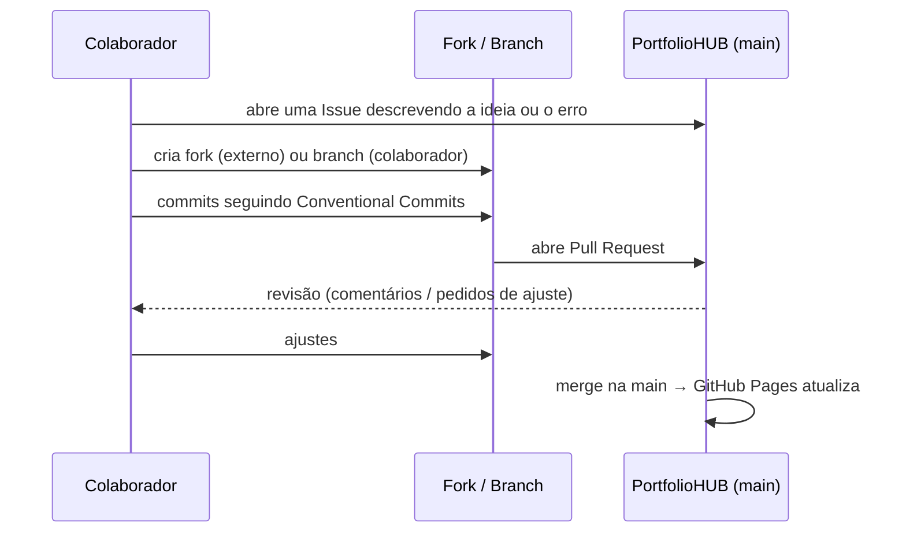

# Guia de Colaboração

Como outras pessoas podem contribuir com o PortfolioHUB — e como eu mesmo organizo as mudanças — usando Issues e Pull Requests.

## Sumário

- [Fluxo de contribuição](#fluxo-de-contribuição)
- [Issues](#issues)
- [Pull Requests](#pull-requests)
- [Revisão de código](#revisão-de-código)
- [Resolvendo conflitos](#resolvendo-conflitos)

## Fluxo de contribuição



1. **Pessoa de fora do projeto:** faz um *fork*, cria uma branch no fork e abre um Pull Request para `main`.
2. **Colaborador com acesso:** cria uma branch direto no repositório (`feature/...`, `docs/...`, `fix/...`).

## Issues

Use as Issues para registrar ideias, erros e tarefas antes de começar a mexer no código. O repositório tem modelos prontos:

- **Relatar um problema** — link quebrado, erro no site, erro em um notebook.
- **Sugerir melhoria** — novo projeto, nova seção, melhoria visual.

Boas práticas: título claro, passos para reproduzir (no caso de erro), print de tela quando ajudar.

## Pull Requests

Todo PR usa o modelo em [`.github/pull_request_template.md`](../.github/pull_request_template.md), que pede:

- **O que muda** — resumo da mudança.
- **Por que** — o problema ou objetivo.
- **Como validar** — passos para a pessoa revisora conferir.
- **Checklist** — README atualizado, links testados, nenhum segredo commitado.

Regras:

- Um PR por assunto (ex.: um projeto novo, ou uma correção).
- PR pequeno é revisado mais rápido.
- Atualize a branch com a `main` antes do merge (`git pull origin main`).

## Revisão de código

Ao revisar, confira:

- [ ] O site abre e os links funcionam.
- [ ] O README do projeto explica objetivo, como executar e estrutura.
- [ ] As mensagens de commit seguem o padrão.
- [ ] Nenhuma chave de API, senha ou arquivo `.env` foi enviado.

## Resolvendo conflitos

Se duas branches mexerem na mesma linha, o Git pede para resolver o conflito:

```bash
git checkout minha-branch
git pull origin main          # traz a main e mostra os conflitos
# editar os arquivos marcados com <<<<<<< ======= >>>>>>>
git add arquivo-resolvido
git commit -m "chore: resolve conflito com a main"
git push
```

---

[← Voltar para Documentação](README.md)
