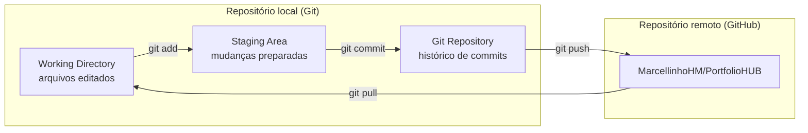
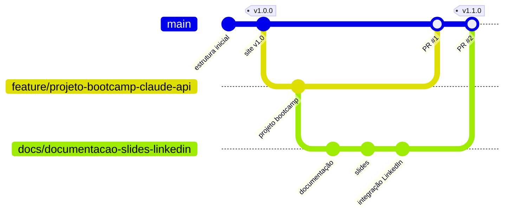

# Guia de Git e Versionamento

Como o PortfolioHUB é versionado: fluxo do Git, padrão de commits, branches e numeração de versões.

## Sumário

- [Fluxo local → remoto](#fluxo-local--remoto)
- [Comandos do dia a dia](#comandos-do-dia-a-dia)
- [Padrão de mensagens de commit](#padrão-de-mensagens-de-commit)
- [Estratégia de branches](#estratégia-de-branches)
- [Versionamento semântico e tags](#versionamento-semântico-e-tags)
- [Histórico real deste repositório](#histórico-real-deste-repositório)

## Fluxo local → remoto

O Git trabalha com três áreas no repositório local. O GitHub guarda a cópia remota.



| Área | O que é | Comando para avançar |
|---|---|---|
| Working Directory | Arquivos como estão no disco | `git add <arquivo>` |
| Staging Area | O que vai entrar no próximo commit | `git commit -m "mensagem"` |
| Git Repository | Histórico local de commits | `git push` |
| GitHub | Cópia remota, pública e compartilhável | `git pull` (traz de volta) |

## Comandos do dia a dia

```bash
# clonar o repositório
git clone https://github.com/MarcellinhoHM/PortfolioHUB.git

# ver o que mudou
git status
git diff

# preparar e registrar mudanças
git add caminho/do/arquivo
git commit -m "feat: descrição curta da mudança"

# enviar e receber do GitHub
git push
git pull

# ver o histórico
git log --oneline --graph --decorate
```

## Padrão de mensagens de commit

Os commits seguem o [Conventional Commits](https://www.conventionalcommits.org/pt-br/):

```
<tipo>(<escopo opcional>): <descrição no imperativo>
```

| Tipo | Quando usar | Exemplo |
|---|---|---|
| `feat` | Nova funcionalidade ou novo projeto | `feat(academicos): adiciona projeto do bootcamp` |
| `fix` | Correção de erro | `fix(site): corrige link quebrado do LinkedIn` |
| `docs` | Somente documentação | `docs: adiciona guia de GitHub Pages` |
| `style` | Formatação/visual, sem mudar lógica | `style(site): ajusta espaçamento dos cards` |
| `refactor` | Reorganização de código | `refactor: move imagens para assets/img` |
| `chore` | Tarefas de manutenção | `chore: atualiza .gitignore` |

Boas práticas:

- Um commit = uma mudança lógica.
- Descrição curta (até ~72 caracteres) e corpo explicando o **porquê**, quando necessário.
- Nunca versionar segredos (`.env`, chaves de API). Use `.env.example`.

## Estratégia de branches

O projeto usa um fluxo simples baseado em *feature branches* (GitHub Flow):



| Branch | Uso |
|---|---|
| `main` | Versão estável, publicada no GitHub Pages. Não recebe commits diretos de funcionalidades. |
| `feature/<nome>` | Novos projetos ou funcionalidades do site. |
| `docs/<nome>` | Mudanças de documentação. |
| `fix/<nome>` | Correções. |

Passo a passo de uma mudança:

```bash
git checkout main
git pull
git checkout -b feature/minha-mudanca
# ... editar arquivos ...
git add .
git commit -m "feat: minha mudança"
git push -u origin feature/minha-mudanca
# abrir o Pull Request no GitHub, revisar e fazer o merge na main
```

Detalhes sobre Pull Requests e revisão estão no [Guia de Colaboração](guia-colaboracao.md).

## Versionamento semântico e tags

As versões seguem o [SemVer](https://semver.org/lang/pt-BR/) — `MAJOR.MINOR.PATCH`:

- **MAJOR**: mudança grande que quebra a estrutura anterior (ex.: reorganizar todo o site).
- **MINOR**: algo novo e compatível (ex.: novo projeto, nova seção).
- **PATCH**: correções pequenas (ex.: link quebrado, erro de digitação).

Cada versão vira uma *tag* anotada e uma *Release* no GitHub:

```bash
git tag -a v1.1.0 -m "Versão 1.1.0 — documentação, slides e LinkedIn"
git push origin v1.1.0
```

As mudanças de cada versão ficam registradas no [CHANGELOG](../CHANGELOG.md).

## Histórico real deste repositório

| Versão | O que entrou |
|---|---|
| `v1.0.0` | Estrutura de diretórios e primeira versão do site no GitHub Pages. |
| `v1.1.0` | Projeto do bootcamp, documentação, slides, integração com LinkedIn e README completo. |

Veja todas as versões em [Releases](https://github.com/MarcellinhoHM/PortfolioHUB/releases).

---

[← Voltar para Documentação](README.md)
