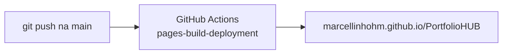

# Guia do GitHub Pages

Como o site do PortfolioHUB é publicado e como atualizá-lo.

**Site no ar:** https://marcellinhohm.github.io/PortfolioHUB/

## Sumário

- [Como funciona](#como-funciona)
- [Configuração usada](#configuração-usada)
- [Arquivos do site](#arquivos-do-site)
- [Como atualizar o site](#como-atualizar-o-site)
- [Testar localmente](#testar-localmente)

## Como funciona

O GitHub Pages publica arquivos estáticos (HTML, CSS, JS, imagens) direto de uma branch do repositório. A cada `push` na `main`, o GitHub gera uma nova versão do site em poucos minutos.



## Configuração usada

Em **Settings → Pages** do repositório:

| Opção | Valor |
|---|---|
| Source | Deploy from a branch |
| Branch | `main` |
| Pasta | `/ (root)` |

O arquivo `.nojekyll` na raiz desativa o processamento do Jekyll, então o site é publicado exatamente como está no repositório.

## Arquivos do site

```
PortfolioHUB/
├── index.html              # página principal
├── .nojekyll               # publica os arquivos sem processamento
├── assets/
│   ├── css/style.css       # estilos (tema claro/escuro, responsivo)
│   ├── js/main.js          # menu mobile, tema e animações
│   └── img/                # imagens
└── documentacao/
    └── slides/index.html   # apresentação em slides (abre no navegador)
```

A página reúne:

- **Sobre** — apresentação pessoal.
- **Projetos** — cards com os projetos acadêmicos e pessoais, com links para código e demo.
- **Documentação** — atalhos para os guias desta pasta.
- **Slides** — a apresentação do repositório, embutida na página.
- **Versões** — linha do tempo das releases.
- **Contato** — LinkedIn e GitHub.

## Como atualizar o site

1. Crie uma branch: `git checkout -b feature/atualiza-site`.
2. Edite `index.html` ou `assets/css/style.css`.
3. Teste localmente (abaixo).
4. Faça commit, `push` e abra um Pull Request.
5. Depois do merge na `main`, acompanhe a publicação em **Actions → pages-build-deployment**.

## Testar localmente

Qualquer servidor estático serve. Com Python:

```bash
cd PortfolioHUB
python -m http.server 8000
# abrir http://localhost:8000
```

---

[← Voltar para Documentação](README.md)
