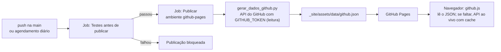

# Ambiente GitHub e Integração com o PortfolioHUB

Seção 2 da Entrega Final: o ambiente GitHub dedicado ao projeto e as funcionalidades do GitHub integradas ao site.

## Sumário

- [Visão geral](#visão-geral)
- [Configuração do repositório](#configuração-do-repositório)
- [Publicação via GitHub Actions](#publicação-via-github-actions)
- [Ambiente github-pages](#ambiente-github-pages)
- [Integração com o site](#integração-com-o-site)
- [Como verificar](#como-verificar)

## Visão geral

O site é estático, então o **GitHub Actions faz o papel de backend no momento da publicação**: consulta a API do GitHub com o token do próprio workflow e grava um JSON público que o site lê. O navegador nunca recebe token nenhum.



| Funcionalidade do GitHub | Papel no PortfolioHUB |
|---|---|
| Repositório | Armazenamento dos projetos, versionado por pastas |
| Issues, Milestones, Labels | Planejamento: uma issue por fase no [milestone v2.0.0](https://github.com/MarcellinhoHM/PortfolioHUB/milestone/1) |
| Pull Requests + Rulesets | Única porta de entrada para a `main` |
| Actions | CI (testes e varredura de segredos) e publicação |
| Environments | Ambiente de produção `github-pages`, restrito à `main` e às tags `v*` |
| Pages | Hospedagem do site |
| API REST | Repositórios, versão em produção, último commit e contribuidores exibidos no site |
| Releases | Versões publicadas (v1.0.0, v1.1.0, v2.0.0) |
| Security (Dependabot, CodeQL, secret scanning) | Ver [politica-de-seguranca.md](politica-de-seguranca.md) |

## Configuração do repositório

| Configuração | Valor | Motivo |
|---|---|---|
| Visibilidade | Pública | O portfólio é feito para ser visto e compartilhado |
| Descrição, site e tópicos | Preenchidos | Facilita encontrar o projeto e liga o repositório ao site |
| Wiki | Desativada | A documentação vive no repositório, versionada e revisada por PR |
| Apagar branch após o merge | Ativado | Mantém o repositório limpo |
| Métodos de merge | Merge commit e squash (rebase desativado) | Histórico legível, um ponto de merge por PR |
| Actions permitidas | Do GitHub, de criadores verificados e o gitleaks | Reduz o risco de usar Actions de terceiros desconhecidos |
| Token padrão dos workflows | Somente leitura | Cada workflow pede explicitamente só o que precisa |
| Workflows de forks | Exigem aprovação para qualquer contribuidor externo | Código de terceiros só roda no CI depois de revisado |

Comandos usados (GitHub CLI):

```bash
R=MarcellinhoHM/PortfolioHUB
gh api -X PATCH repos/$R -F delete_branch_on_merge=true -F has_wiki=false -F allow_rebase_merge=false
gh api -X PUT repos/$R/actions/permissions -F enabled=true -f allowed_actions=selected
gh api -X PUT repos/$R/actions/permissions/workflow -f default_workflow_permissions=read -F can_approve_pull_request_reviews=false
gh api -X PUT repos/$R/actions/permissions/fork-pr-contributor-approval -f approval_policy=all_external_contributors
```

## Publicação via GitHub Actions

*Settings → Pages → Build and deployment → Source: **GitHub Actions***

```bash
gh api -X PUT repos/MarcellinhoHM/PortfolioHUB/pages -f build_type=workflow
```

O workflow [`deploy-pages.yml`](../../.github/workflows/deploy-pages.yml) roda a cada push na `main`, a cada Release publicada (para o site mostrar a nova versão), uma vez por dia (para atualizar os dados do GitHub) e sob demanda:

1. **Testes antes de publicar:** roda a mesma suíte do CI. Se falhar, nada é publicado.
2. **Publicar:** monta a pasta `_site` só com os arquivos do site (ferramentas, testes e configurações ficam de fora), gera o `github.json` e publica no ambiente `github-pages`.

Todas as Actions são fixadas pelo SHA do commit, com a versão em comentário, e o Dependabot propõe as atualizações.

## Ambiente github-pages

*Settings → Environments → github-pages → Deployment branches and tags: **Selected branches and tags***

| Regra | Tipo | Para quê |
|---|---|---|
| `main` | branch | Publicação normal |
| `v*` | tag | Republicar uma versão anterior em caso de rollback |

As tags `v*` são protegidas pela ruleset "Tags de versão": só o mantenedor cria, altera ou apaga. Assim a regra de tag do ambiente não vira uma porta de entrada para publicações não autorizadas.

O histórico de publicações fica em *Environments → github-pages* e na aba *Actions*.

## Integração com o site

| Seção do site | Dados | Fonte |
|---|---|---|
| **Repositórios no GitHub** | Repositórios públicos próprios (sem forks e arquivados), com linguagem, estrelas, data de atualização, link do código e do site; filtro por texto | `github.json` (build) → API `/users/MarcellinhoHM/repos` |
| **Implantação → Versão em produção** | Última Release | `github.json` → API `/releases/latest` |
| **Implantação → Último commit** | SHA, mensagem e data | `github.json` → API `/commits` |
| **Implantação → Testes e Publicação** | Status dos workflows | Badges do GitHub Actions |
| **Implantação → Equipe** | Contribuidores com avatar e número de commits | `github.json` → API `/contributors` |

Código: [`scripts/gerar_dados_github.py`](../../scripts/gerar_dados_github.py) (build) e [`assets/js/github.js`](../../assets/js/github.js) (navegador).

Cuidados de segurança na integração:

- O JSON público só tem campos escolhidos a dedo; o token do workflow nunca é gravado.
- No navegador, os dados entram na página só com `textContent`, e todo link passa por validação (`https:`) antes de ir para o `href`.
- A CSP libera conexões apenas para o próprio site e para `api.github.com`; estilos e fontes só do próprio site.
- O cache de 10 minutos na sessão protege contra o limite de 60 requisições por hora da API anônima.

Resultado prático: **criar um repositório público novo faz ele aparecer no portfólio** na próxima publicação (ou na hora, pela API ao vivo), e **publicar uma Release atualiza a versão em produção** exibida no site.

## Como verificar

| Verificação | Onde |
|---|---|
| Fonte do Pages = GitHub Actions | *Settings → Pages* |
| Execuções verdes de "Publicar no GitHub Pages" | [Aba Actions](https://github.com/MarcellinhoHM/PortfolioHUB/actions/workflows/deploy-pages.yml) |
| Histórico de publicações e regras do ambiente | *Settings → Environments → github-pages* |
| Dados vindos do build | https://marcellinhohm.github.io/PortfolioHUB/assets/data/github.json |
| Seções dinâmicas | [Repositórios](https://marcellinhohm.github.io/PortfolioHUB/#repositorios) e [Implantação](https://marcellinhohm.github.io/PortfolioHUB/#implantacao) |

---

[← Voltar para a documentação da implantação](README.md)
