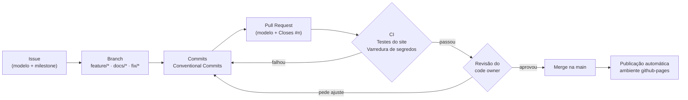

# Compartilhamento, Controle de Acesso e Colaboração

Seção 4 da Entrega Final: como o repositório é compartilhado, como o acesso é controlado e como a colaboração funciona na prática. Complementa o [Guia de Colaboração](../guia-colaboracao.md) e o [Guia de Git e Versionamento](../guia-git-e-versionamento.md) da etapa anterior, agora com o fluxo protegido.

## Sumário

- [Formas de compartilhamento](#formas-de-compartilhamento)
- [Quem pode fazer o quê](#quem-pode-fazer-o-quê)
- [Fluxo de colaboração protegido](#fluxo-de-colaboração-protegido)
- [Ferramentas colaborativas usadas](#ferramentas-colaborativas-usadas)
- [Processo de configuração (passo a passo)](#processo-de-configuração-passo-a-passo)
- [Evidência: a própria implantação](#evidência-a-própria-implantação)

## Formas de compartilhamento

| Para quem | Como | Link |
|---|---|---|
| Recrutadores e público | Site no GitHub Pages | https://marcellinhohm.github.io/PortfolioHUB/ |
| Quem quer ver o código | Repositório público | https://github.com/MarcellinhoHM/PortfolioHUB |
| Quem quer usar ou estudar | Clone ou download | `git clone https://github.com/MarcellinhoHM/PortfolioHUB.git` |
| Quem quer contribuir | Fork + Pull Request | *Fork* no GitHub, depois PR para a `main` |
| Rede profissional | LinkedIn (projeto e destaque) | Ver [integração com o LinkedIn](../integracao-linkedin.md) |
| Uma versão específica | Releases e tags | https://github.com/MarcellinhoHM/PortfolioHUB/releases |

O código é distribuído sob a [licença MIT](../../LICENSE): qualquer pessoa pode usar, copiar e modificar, mantendo o aviso de copyright.

## Quem pode fazer o quê

**Leitura é aberta; escrita é controlada.**

| Ação | Visitante | Colaborador | Mantenedor |
|---|---|---|---|
| Ler código, clonar, baixar | ✅ | ✅ | ✅ |
| Abrir issue | ✅ | ✅ | ✅ |
| Fork + PR | ✅ (workflows só rodam após aprovação) | ✅ | ✅ |
| Criar branch no repositório | ❌ | ✅ | ✅ |
| Mesclar na `main` | ❌ | Só com aprovação do code owner e CI verde | Por PR, com bypass registrado |
| Push direto na `main` | ❌ | ❌ | ❌ |
| Criar ou apagar tags `v*` e Releases | ❌ | ❌ | ✅ |
| Mudar configurações | ❌ | ❌ | ✅ |

Detalhes, inventário e procedimentos de concessão e revogação: [gestao-de-usuarios.md](gestao-de-usuarios.md).

## Fluxo de colaboração protegido



1. **Issue:** descreve o problema ou a ideia, usando um dos modelos, e entra num milestone.
2. **Branch:** criada a partir da `main` atualizada (`feature/`, `docs/` ou `fix/`).
3. **Commits:** pequenos e no padrão Conventional Commits.
4. **Pull Request:** usa o [modelo](../../.github/pull_request_template.md) e fecha a issue com `Closes #n`.
5. **CI:** os dois checks obrigatórios precisam passar.
6. **Revisão:** o code owner aprova; um push novo descarta a aprovação; conversas precisam ser resolvidas.
7. **Merge:** a branch é apagada automaticamente e a publicação roda sozinha.

## Ferramentas colaborativas usadas

| Ferramenta | Uso no projeto |
|---|---|
| Issues + modelos | Relatar problemas e sugerir melhorias com campos padronizados |
| Milestones | [v2.0.0 — Implantação](https://github.com/MarcellinhoHM/PortfolioHUB/milestone/1), com uma issue por fase |
| Labels | `implantação`, `segurança`, `colaboração`, `ci-cd`, `dependências`, `documentation` |
| Pull Requests + modelo | Única forma de alterar a `main` |
| CODEOWNERS | Revisor responsável por caminho |
| GitHub Actions | Checks automáticos em todo PR |
| Dependabot | PRs automáticos de atualização, que passam pelo mesmo fluxo |
| Relato privado de vulnerabilidades | Canal seguro para falhas de segurança |
| CONTRIBUTING + CODE_OF_CONDUCT | Regras para quem quer contribuir |
| Claude (guia) | Apoio no planejamento e na revisão, com transcrições versionadas |

## Processo de configuração (passo a passo)

Tudo foi configurado pela GitHub CLI (`gh`), na ordem recomendada pelo guia: segurança antes de abrir acesso e de automatizar.

```bash
R=MarcellinhoHM/PortfolioHUB

# 1. Planejamento: labels, milestone e issues
gh label create "implantação" -R $R --color 7b2d8e
gh api -X POST repos/$R/milestones -f title="v2.0.0 — Implantação (Entrega Final)" -f due_on=2026-10-25T23:55:00-03:00
gh issue create -R $R --title "F1 · Planejamento..." --milestone "v2.0.0 — Implantação (Entrega Final)"

# 2. Segurança do repositório
gh api -X PUT repos/$R/vulnerability-alerts            # Dependabot alerts
gh api -X PUT repos/$R/automated-security-fixes        # Dependabot security updates
gh api -X PUT repos/$R/private-vulnerability-reporting
gh api -X PATCH repos/$R/code-scanning/default-setup -f state=configured   # CodeQL
# secret scanning + push protection: PATCH repos/$R com security_and_analysis

# 3. Actions
gh api -X PUT repos/$R/actions/permissions/workflow -f default_workflow_permissions=read
gh api -X PUT repos/$R/actions/permissions/fork-pr-contributor-approval -f approval_policy=all_external_contributors

# 4. Pages via Actions e ambiente
gh api -X PUT repos/$R/pages -f build_type=workflow
gh api -X PUT repos/$R/environments/github-pages      # + políticas de branch "main" e tag "v*"

# 5. Rulesets (JSON completo em gestao-de-usuarios.md)
gh api -X POST repos/$R/rulesets --input protecao-main.json
gh api -X POST repos/$R/rulesets --input tags-de-versao.json
```

Arquivos versionados que fazem parte da configuração:

| Arquivo | Função |
|---|---|
| [`.github/workflows/ci.yml`](../../.github/workflows/ci.yml) | Checks obrigatórios do PR |
| [`.github/workflows/deploy-pages.yml`](../../.github/workflows/deploy-pages.yml) | Publicação no ambiente `github-pages` |
| [`.github/dependabot.yml`](../../.github/dependabot.yml) | Atualizações automáticas |
| [`.github/CODEOWNERS`](../../.github/CODEOWNERS) | Responsáveis pela revisão |
| [`.github/pull_request_template.md`](../../.github/pull_request_template.md) e [`ISSUE_TEMPLATE/`](../../.github/ISSUE_TEMPLATE/) | Modelos |
| [`SECURITY.md`](../../SECURITY.md), [`CONTRIBUTING.md`](../../CONTRIBUTING.md), [`CODE_OF_CONDUCT.md`](../../CODE_OF_CONDUCT.md) | Políticas públicas |

## Evidência: a própria implantação

A implantação passou pelo fluxo que ela mesma criou:

- As fases viraram as issues #3 a #8 no milestone v2.0.0.
- Todo o trabalho foi feito na branch `feature/implantacao-final` e entrou na `main` por um Pull Request que fecha as issues das fases concluídas.
- O PR só pôde ser mesclado com os dois checks verdes; como o mantenedor não pode aprovar o próprio PR, o merge usou o bypass registrado no próprio PR.
- O push direto na `main` foi testado e recusado ([testes-e-lancamento.md](testes-e-lancamento.md#push-direto-na-main)).

**Próximo passo para fortalecer a evidência:** convidar um colega como colaborador e fazer um ciclo completo com revisão real (issue → branch dele → PR → revisão com comentário → ajuste → aprovação → merge).

---

[← Voltar para a documentação da implantação](README.md)
