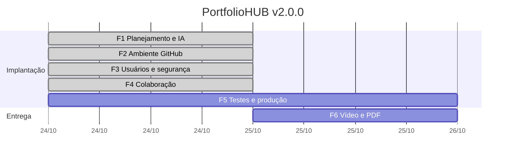

# Plano de Implantação — PortfolioHUB v2.0.0

| Campo | Valor |
|---|---|
| Projeto | PortfolioHUB, portfólio profissional |
| Responsável | Marcello Augusto Hesketh Montella |
| Disciplina | Bootcamp I, Entrega Final |
| Repositório | https://github.com/MarcellinhoHM/PortfolioHUB |
| Produção | https://marcellinhohm.github.io/PortfolioHUB/ |
| Versão de partida | `v1.1.0` (Entrega Intermediária) |
| Versão alvo | `v2.0.0` |
| Prazo | 25/10/2026, 23h55 |
| IA de apoio | Claude (Anthropic), no papel que o enunciado atribui ao Google Gemini — ver [ia-guia.md](ia-guia.md) |
| Acompanhamento | [Milestone v2.0.0](https://github.com/MarcellinhoHM/PortfolioHUB/milestone/1), uma issue por fase (#3 a #8) |

> Este plano foi elaborado com o Claude como guia (prompt 6 da [trilha](../../ferramentas/guia-implantacao-claude/transcricoes/trilha.md)) e adaptado ao calendário real da implantação.

## Sumário

1. [Objetivo](#1-objetivo)
2. [Escopo](#2-escopo)
3. [Estado inicial](#3-estado-inicial)
4. [Premissas, restrições e decisões](#4-premissas-restrições-e-decisões)
5. [Ferramentas](#5-ferramentas)
6. [Fases, tarefas e critérios de pronto](#6-fases-tarefas-e-critérios-de-pronto)
7. [Cronograma](#7-cronograma)
8. [Riscos e mitigação](#8-riscos-e-mitigação)
9. [Plano de reversão (rollback)](#9-plano-de-reversão-rollback)
10. [Critérios de aceite](#10-critérios-de-aceite)

## 1. Objetivo

Levar o PortfolioHUB de "repositório versionado e publicado" (`v1.1.0`) a **produto em produção** (`v2.0.0`), com:

- ambiente GitHub dedicado, com publicação automatizada e validada;
- gestão de acesso pelo menor privilégio;
- políticas de segurança ativas e verificáveis;
- fluxo de colaboração protegido e documentado;
- documentação completa da implantação e do uso da IA como guia.

## 2. Escopo

| Dentro do escopo | Fora do escopo (e por quê) |
|---|---|
| Plano, milestone, issues e IA como guia | Backend, banco de dados ou login no site: o site é estático e "login" em JavaScript não oferece segurança real |
| Publicação via GitHub Actions no ambiente `github-pages` | Chamar a API do Claude a partir do site: exigiria expor a chave no navegador |
| Integração do site com a API pública do GitHub | Domínio próprio: não exigido |
| Ruleset, CODEOWNERS, secret scanning, Dependabot, CodeQL, SECURITY.md, CSP | Transferir para uma Organization: quebraria as URLs já divulgadas (ver D2) |
| CI com testes e varredura de segredos | |
| Produção: 404, favicon, sitemap, checklist, Release `v2.0.0` | |
| Roteiro, slides e vídeo de 5 minutos | |

## 3. Estado inicial

| Área | Situação na `v1.1.0` | Lacuna |
|---|---|---|
| Estrutura e documentação | READMEs por pasta, CONTRIBUTING, CHANGELOG, guias | Faltava a documentação de implantação e de segurança |
| Versionamento | SemVer, tags anotadas, Releases v1.0.0 e v1.1.0, PRs #1 e #2 | Sem revisão obrigatória |
| Publicação | Pages com *Deploy from a branch* | Nada validava o site antes de publicar |
| Segredos | `.env` ignorado, `.env.example` | Sem secret scanning e push protection |
| Segurança do repositório | Padrão do GitHub | Sem ruleset, SECURITY.md, Dependabot e CodeQL |

**Ponto de restauração:** tag `v1.1.0`, commit `f741d68` da `main`.

## 4. Premissas, restrições e decisões

**Restrições**

- Site 100% estático: sem servidor e sem segredos no front-end ou no repositório.
- O GitHub Pages não permite cabeçalhos HTTP próprios: a CSP é aplicada por `<meta>` (cobertura parcial, sem `frame-ancestors`).
- Em repositório de **conta pessoal**, colaboradores convidados recebem acesso de escrita. Os papéis granulares (Read, Triage, Maintain) só existem em Organizations.
- A API do GitHub sem login permite 60 requisições por hora por IP.

**Decisões**

| ID | Decisão | Opções | Escolha | Motivo |
|---|---|---|---|---|
| D1 | IA de apoio | Gemini / Claude | **Claude** | Já usado no projeto do bootcamp (API e SDK em Python); equivalência documentada em [ia-guia.md](ia-guia.md) |
| D2 | Onde fica o repositório | A: conta pessoal / B: Organization | **A** | Mantém as URLs do site, do LinkedIn e da entrega anterior. A limitação de papéis é compensada pela ruleset e pelo CODEOWNERS |
| D3 | Fonte de publicação do Pages | Branch / GitHub Actions | **Actions** | Permite rodar testes antes e bloquear a publicação se falharem |
| D4 | Integração GitHub → site | Links fixos / API pública | **API pública** | Lista de repositórios, versão e equipe sempre atualizadas, com mensagem de falha e cache |

## 5. Ferramentas

| Ferramenta | Uso |
|---|---|
| Git, VS Code, GitHub CLI (`gh`) | Desenvolvimento, branches, PRs, issues, Releases e configuração do repositório |
| GitHub Issues + Milestones + Labels | Planejamento e acompanhamento das fases |
| GitHub Rulesets + CODEOWNERS | Proteção da `main` e responsáveis pela revisão |
| Secret scanning, push protection, Dependabot, CodeQL | Detecção de segredos, dependências vulneráveis e falhas no código |
| GitHub Actions + Environments | CI (testes e gitleaks) e publicação no ambiente `github-pages` |
| API REST pública do GitHub | Dados ao vivo no site |
| Python `unittest` | Testes automatizados do site |
| Claude (API da Anthropic) | Guia da trilha de implantação |

## 6. Fases, tarefas e critérios de pronto

A segurança foi configurada **antes** de automatizar a publicação, como recomendou o guia.

### F1 · Planejamento e IA como guia — [#3](https://github.com/MarcellinhoHM/PortfolioHUB/issues/3)

- [x] Claude configurado como guia: [system prompt](../../ferramentas/guia-implantacao-claude/system_prompt.md) e [trilha de prompts](../../ferramentas/guia-implantacao-claude/trilha.json)
- [x] Trilha executada e transcrição salva
- [x] Este plano
- [x] Milestone, labels e uma issue por fase
- [x] Registro de uso da IA em [ia-guia.md](ia-guia.md)

**Pronto quando:** plano e guia mesclados na `main` por PR.

### F2 · Ambiente GitHub e integração — [#4](https://github.com/MarcellinhoHM/PortfolioHUB/issues/4)

- [x] *Settings → Pages → Source: GitHub Actions*
- [x] Workflow [`deploy-pages.yml`](../../.github/workflows/deploy-pages.yml), que só publica depois dos testes
- [x] Ambiente `github-pages` aceitando só a branch `main`
- [x] Site lendo a API do GitHub ([`github.js`](../../assets/js/github.js)): repositórios, versão em produção, último commit e equipe

**Pronto quando:** o deploy roda pelo workflow e aparece em *Environments*.

### F3 · Gestão de usuários e segurança — [#5](https://github.com/MarcellinhoHM/PortfolioHUB/issues/5)

- [x] Ruleset "Proteção da main": PR obrigatório, 2 checks obrigatórios, conversas resolvidas, sem force push, sem exclusão; bypass do admin só via PR
- [x] [CODEOWNERS](../../.github/CODEOWNERS)
- [x] Secret scanning + push protection
- [x] Dependabot (alertas, atualizações de segurança e [`dependabot.yml`](../../.github/dependabot.yml))
- [x] CodeQL (configuração padrão)
- [x] Relato privado de vulnerabilidades e [SECURITY.md](../../SECURITY.md)
- [x] Token dos workflows somente leitura por padrão; só Actions do GitHub, verificadas ou o gitleaks; Actions fixadas por SHA
- [x] CSP sem `unsafe-inline` em todas as páginas, `noopener` nos links externos, dados da API só via `textContent`
- [ ] 2FA na conta do GitHub (conferir em *Settings → Password and authentication*)

**Pronto quando:** push direto na `main` é recusado (comprovado em [testes-e-lancamento.md](testes-e-lancamento.md#push-direto-na-main)).

### F4 · Compartilhamento e colaboração — [#6](https://github.com/MarcellinhoHM/PortfolioHUB/issues/6)

- [x] Fluxo Issue → branch → PR → CI → revisão → merge documentado em [compartilhamento-e-colaboracao.md](compartilhamento-e-colaboracao.md)
- [x] [CODE_OF_CONDUCT.md](../../CODE_OF_CONDUCT.md) e CONTRIBUTING atualizado
- [x] Tabela de controle de acesso em [gestao-de-usuarios.md](gestao-de-usuarios.md)
- [ ] Ciclo com um colaborador externo (convite pendente, ver R2)

**Pronto quando:** a implantação entra na `main` por PR com os checks verdes.

### F5 · Testes e produção — [#7](https://github.com/MarcellinhoHM/PortfolioHUB/issues/7)

- [x] [CI](../../.github/workflows/ci.yml): testes automatizados e gitleaks no histórico completo
- [x] 404, favicon, sitemap, Open Graph
- [x] Checklist de produção em [testes-e-lancamento.md](testes-e-lancamento.md)
- [x] Revisão da implantação com o guia ([transcrição](../../ferramentas/guia-implantacao-claude/transcricoes/revisao.md))
- [x] CHANGELOG, tag e Release `v2.0.0`

**Pronto quando:** CI e deploy verdes na `main` e Release publicada.

### F6 · Apresentação — [#8](https://github.com/MarcellinhoHM/PortfolioHUB/issues/8)

- [x] [Roteiro de 5 minutos](roteiro-apresentacao-final.md) e [slides](https://marcellinhohm.github.io/PortfolioHUB/documentacao/slides/implantacao/)
- [ ] Vídeo no YouTube
- [ ] PDF enviado

## 7. Cronograma

| Data | Fase | Marco |
|---|---|---|
| 16/10 | — | Entrega Intermediária, `v1.1.0` |
| 24/10 | F1 a F3 | Trilha com o guia, plano, milestone, segurança e ambiente GitHub configurados |
| 24/10 | F4 e F5 | PR da implantação com CI verde, revisão com o guia |
| 25/10 | F5 e F6 | Merge, Release `v2.0.0`, vídeo e envio do PDF até 23h55 |

## 8. Riscos e mitigação

| ID | Risco | Prob. | Impacto | Mitigação |
|---|---|---|---|---|
| R1 | Professor não aceitar o Claude no lugar do Gemini | Baixa | Alto | Equivalência seção a seção em [ia-guia.md](ia-guia.md) |
| R2 | Sem colaborador externo para demonstrar o fluxo | Média | Médio | Fluxo demonstrado com o PR da implantação e com os PRs do Dependabot, que também passam pela ruleset; convite a um colega como próximo passo. Não criar conta extra (os Termos do GitHub limitam uma conta gratuita por pessoa) |
| R3 | Ruleset bloquear o próprio dono | Média | Médio | 0 aprovações obrigatórias e bypass do admin só via PR |
| R4 | Chave da API vazar | Baixa | Alto | `.gitignore`, push protection, gitleaks e teste automatizado de padrões de chave |
| R5 | Publicação via Actions quebrar o site | Média | Alto | Testes antes do deploy; restauração pela tag `v1.1.0` (RB1) |
| R6 | CSP bloquear recursos do próprio site | Média | Médio | Teste automatizado da CSP e conferência no console do navegador |
| R7 | Limite da API do GitHub esvaziar as seções dinâmicas | Média | Baixo | Cache de 10 minutos na sessão e mensagem com link para o GitHub |
| R8 | Prazo curto | Alta | Alto | Escopo fechado e itens opcionais cortados primeiro |

## 9. Plano de reversão (rollback)

Toda mudança entra por PR, e a reversão também.

| ID | Situação | Procedimento |
|---|---|---|
| RB1 | Publicação quebrou o site | `git revert` do merge em uma branch, PR e merge (gera nova publicação). Urgente: *Settings → Pages → Source: Deploy from a branch* (`main` na tag `v1.1.0`) |
| RB2 | Ruleset impede trabalho legítimo | *Settings → Rules → Rulesets → Proteção da main → Enforcement: Disabled*, corrigir e reativar no mesmo dia, registrando o motivo |
| RB3 | Segredo exposto | 1) Revogar a chave no console do provedor (é a correção real). 2) Gerar nova chave só no `.env` local. 3) Limpar o histórico com `git filter-repo` (exige desativar o bloqueio de force push temporariamente). 4) Reativar a ruleset e registrar o incidente |
| RB4 | CI falhando sem motivo | Corrigir o teste ou a configuração por PR. Nunca remover o check da ruleset |
| RB5 | Release errada | Antes de divulgar: apagar a Release e a tag e recriar. Depois de divulgar: publicar `v2.0.1` |
| RB6 | Atualização do Dependabot quebrou algo | `git revert` do merge por PR |
| RB7 | Colaborador com acesso indevido | *Settings → Collaborators → Remove*, revisar os commits recentes e atualizar a tabela de acesso |

## 10. Critérios de aceite

| Critério de avaliação | Aceite | Evidência |
|---|---|---|
| Implementação | Publicação via Actions, ambiente `github-pages`, site integrado à API do GitHub | Execução do workflow, *Settings → Environments*, seção Repositórios/Implantação do site |
| Segurança | Ruleset ativa com checks obrigatórios; secret scanning, push protection, Dependabot e CodeQL ativos; SECURITY.md; CSP | *Settings → Rules*, aba *Security*, push recusado |
| Documentação | Esta pasta completa e linkada no README e no site | Links |
| Colaboração | Issues no milestone, PR com checks e revisão, templates, CODEOWNERS | Milestone, PR da implantação |
| Apresentação | Vídeo de até 5 minutos cobrindo as 6 seções | Link do YouTube |

---

[← Voltar para a documentação da implantação](README.md)
