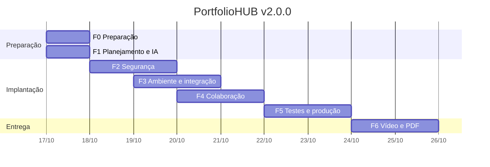

# Trilha de Implantação do PortfolioHUB — etapa "trilha"

- Data: 24/10/2026 13:54
- Modelo: `claude-opus-5-5` (esforço `medium`)
- Configuração do guia: [`system_prompt.md`](../system_prompt.md)

## Prompt 1: apresentação inicial

Sou aluno de Ciência da Computação e estou cursando a disciplina Bootcamp I. Nela estou construindo o PortfolioHUB, meu portfólio profissional: um repositório público no GitHub com meus projetos acadêmicos e pessoais e um site publicado no GitHub Pages. Agora estou na Entrega Final, que é a implantação do PortfolioHUB.

### Resposta ao Prompt 1

# Trilha de implantação do PortfolioHUB (Entrega Final)

Olá, Marcello! Vou te guiar pelos 6 itens da Entrega Final, sempre com passos verificáveis e a evidência que você pode mostrar na banca.

> **Nota para o plano:** o enunciado cita o Google Gemini como IA de apoio. Registre no documento que você usou o **Claude (Anthropic)** no mesmo papel, de guia de implantação. Assim fica claro que o requisito foi atendido com outra ferramenta.

## Visão geral da trilha

| # | Item da entrega | O que será feito | Evidência principal |
|---|---|---|---|
| 1 | Plano + IA como guia | `docs/implantacao/plano-de-implantacao.md`, `docs/implantacao/ia-guia.md`, milestone e issues | Documento + milestone `v2.0.0` |
| 2 | Ambiente GitHub e funcionalidades | Projects, templates de Issue/PR, labels, Actions, Pages via Actions | Board do Project + workflows verdes |
| 3 | Usuários e segurança | 2FA, ruleset na `main`, secret scanning, Dependabot, CodeQL, `SECURITY.md` | Prints de *Settings* + aba *Security* |
| 4 | Colaboração e acesso | Colaborador com papel mínimo, `CONTRIBUTING.md`, `CODEOWNERS`, PR de teste | PR revisado e mesclado + tabela de acessos |
| 5 | Integração, testes e produção | CI de validação de HTML e links, checagem de segredos, Release `v2.0.0` | Release publicada + site no ar |
| 6 | Apresentação de 5 min | Roteiro e demo ao vivo | Slides HTML atualizados |

## Passo 0: diagnóstico do estado atual

Rode os comandos abaixo antes de mudar qualquer coisa. Eles mostram de onde você está partindo.

```bash
gh auth status
gh repo view MarcellinhoHM/PortfolioHUB \
  --json visibility,defaultBranchRef,hasIssuesEnabled,hasProjectsEnabled,hasWikiEnabled
gh api repos/MarcellinhoHM/PortfolioHUB/pages --jq '{status, source, build_type, html_url}'
gh api repos/MarcellinhoHM/PortfolioHUB/rulesets
git tag --list
```

### Risco crítico: chave da API do Claude no histórico

Como os notebooks usam a API do Claude, verifique se alguma chave já foi commitada:

```bash
git log -p --all -S "sk-ant" --oneline
grep -rn "sk-ant" --include="*.ipynb" --include="*.py" .
```

- **Se aparecer algo:** primeiro **revogue a chave** no Console da Anthropic (*Settings → API Keys*) e só depois limpe o código. Uma chave que esteve num repositório público deve ser tratada como comprometida, mesmo depois de apagada do histórico.
- **Prevenção:** a chave fica só em variável de ambiente local (`ANTHROPIC_API_KEY`), num `.env` listado no `.gitignore`, e o código lê com `os.environ["ANTHROPIC_API_KEY"]`. Ela nunca vai para o site, porque é estático e qualquer visitante veria a chave.

## Passo 1: organizar a entrega no próprio GitHub

Usar o GitHub para gerenciar a entrega já serve de evidência para o item 2.

```bash
# Milestone da entrega final
gh api repos/MarcellinhoHM/PortfolioHUB/milestones \
  -f title="v2.0.0 – Entrega Final" \
  -f description="Implantação do PortfolioHUB (Bootcamp I)"

# Labels por item
for l in "implantacao" "seguranca" "colaboracao" "ci-cd" "documentacao"; do
  gh label create "$l" --repo MarcellinhoHM/PortfolioHUB --force
done

# Exemplo de issue
gh issue create --repo MarcellinhoHM/PortfolioHUB \
  --title "Item 3: Políticas de segurança e gestão de acesso" \
  --label seguranca --milestone "v2.0.0 – Entrega Final" \
  --body "- [ ] 2FA\n- [ ] Ruleset main\n- [ ] Secret scanning + push protection\n- [ ] Dependabot\n- [ ] CodeQL\n- [ ] SECURITY.md"
```

Depois crie um **Project** (aba *Projects → New project → Board*) com as colunas *A fazer / Em andamento / Concluído* e vincule as issues a ele.

## Como as referências se ligam ao projeto (sem exagero)

| Referência | Ação prática no PortfolioHUB |
|---|---|
| **OWASP Top 10** (A05 Misconfiguration, A06 Componentes vulneráveis) | Ruleset na `main`, Dependabot no `requirements.txt` |
| **OpenSSF Scorecard** | Checklist de branch protection, token mínimo nos workflows, `SECURITY.md` |
| **NIST CSF** (Identificar, Proteger, Detectar, Responder) | Inventário de acessos, 2FA, alertas de segurança, procedimento de revogação de chave |
| **LGPD** | Revisar dados pessoais expostos no site (e-mail, telefone) e publicar só o necessário |
| **CIS / ISO 27001** | Princípio do menor privilégio na concessão de acesso a colaboradores |

## Por onde quer começar?

Sugiro seguir a ordem **0 → 1 → 3 → 2 → 4 → 5 → 6**. A segurança vem antes de ampliar o acesso e as automações. Me diga qual item quer atacar agora. Se preferir, já te entrego o modelo completo do `plano-de-implantacao.md` para preencher.

---

### Próximos passos
1. Rodar o diagnóstico do Passo 0 e me enviar a saída (sem nenhum token).
2. Fazer a checagem de `sk-ant` no histórico e revogar a chave se ela aparecer.
3. Criar a milestone, as labels e o Project.
4. Escolher o próximo item: sugiro o plano (item 1) ou a segurança (item 3).

### Como comprovar
- Print ou link da **milestone `v2.0.0 – Entrega Final`** com as issues vinculadas.
- Print do **Project (board)** com as tarefas distribuídas.
- Registro no `ia-guia.md` de que o diagnóstico foi feito com apoio do Claude, incluindo a data e o resultado da checagem de segredos.

---

## Prompt 2: comando para que o Claude atue como meu guia de implantação

Atue como meu guia na trilha de implantação do PortfolioHUB. A cada etapa que eu apresentar, me diga o que fazer, em que ordem, como configurar no GitHub e como comprovar que ficou pronto. Vou começar apresentando o que já foi pedido e entregue nas etapas anteriores.

### Resposta ao Prompt 2

Combinado, Marcello. Vou atuar como seu guia durante toda a trilha.

## Como vou responder a cada etapa

| Bloco | Conteúdo |
|---|---|
| **1. Leitura da etapa** | O que foi pedido e o que já existe no repositório. As lacunas aparecem logo no início. |
| **2. Ordem de execução** | Passos numerados, do que destrava os demais ao que fecha a etapa. |
| **3. Configuração** | Caminho de menu no GitHub (*Settings → ...*), comandos `git`/`gh` e arquivos prontos para colar. |
| **4. Riscos e validação** | O que pode dar errado e o teste que confirma que funcionou. |
| **5. Próximos passos / Como comprovar** | A ligação com a etapa seguinte e a evidência para a banca. |

## O que você pode me enviar sobre as etapas anteriores

Quanto mais concreto, melhor o diagnóstico. Use este modelo:

```markdown
### Etapa: <nome>
**O que foi pedido:** <enunciado ou resumo>
**O que foi entregue:** <arquivos, links, tags>
**Onde está no repositório:** <caminhos de pasta/arquivo>
**Pendências ou dúvidas:** <o que ficou incompleto ou inseguro>
```

Também ajudam, se der para colar:

```bash
tree -L 2 -a -I '.git'          # estrutura de pastas (ou: find . -maxdepth 2 -not -path './.git*')
git log --oneline --graph -15   # histórico recente
git tag -n                      # tags v1.0.0 e v1.1.0 com mensagens
gh release list --repo MarcellinhoHM/PortfolioHUB
```

> ⚠️ Antes de colar qualquer saída, confira se não há tokens, chaves (`sk-ant-...`, `ghp_...`) ou e-mails que você não queira expor.

## O que vou fazer com isso

Com o que você enviar, vou montar um **inventário do que já está entregue**, que vira a seção "Estado inicial" do `plano-de-implantacao.md`. Nesse inventário vou separar três coisas:

- **O que só precisa ser reaproveitado:** guias, slides, READMEs.
- **O que precisa de ajuste para produção:** links quebrados, dados pessoais expostos, workflows faltando.
- **O que é novo na Entrega Final:** segurança, gestão de acesso, CI e Release `v2.0.0`.

Pode apresentar a primeira etapa.

---

### Próximos passos
1. Enviar o resumo das etapas anteriores (enunciado e entregas), de preferência com o modelo acima.
2. Colar a saída de `tree`, `git log` e `git tag -n`, já revisada para não conter segredos.
3. Se ainda não fez, rodar a checagem `git log -p --all -S "sk-ant"` da resposta anterior.

### Como comprovar
- O inventário que vamos montar vira a seção **"Estado inicial"** do plano de implantação. Ele mostra à banca de onde o projeto partiu.
- As tags `v1.0.0` e `v1.1.0` listadas com `git tag -n` comprovam as entregas anteriores e servem de base para a `v2.0.0`.

---

## Prompt 3: apresentação do trabalho solicitado na Entrega Intermediária

Apresento o enunciado da Entrega Intermediária (em anexo).

### Resposta ao Prompt 3

Marcello, **o anexo não chegou até mim**. Só recebi o texto da sua mensagem. Para não inventar o que o enunciado pede, preciso que você reenvie o conteúdo.

## Como enviar

| Formato | Como fazer |
|---|---|
| **Texto colado** (melhor opção) | Copie o enunciado do AVA/PDF e cole direto na conversa |
| **PDF ou imagem** | Tente anexar de novo. Se for imagem, confira se o texto está legível |
| **Link** | Não consigo abrir links. Prefira colar o texto |

## O que já sei da Entrega Intermediária

Pelo contexto do projeto, estes itens foram entregues:

- Estrutura de pastas e READMEs
- Guias de Git, colaboração, GitHub Pages e LinkedIn
- Slides em HTML
- Versões `v1.0.0` e `v1.1.0`

Quando o enunciado chegar, vou cruzar **cada requisito com o que foi entregue** e montar esta tabela, que vira a seção "Estado inicial" do plano:

| Requisito do enunciado | Entregue? | Onde está (caminho/tag) | Ajuste para a Entrega Final |
|---|---|---|---|
| ... | ✅ / ⚠️ / ❌ | ... | ... |

Se tiver à mão, cole também a **nota ou o feedback do professor** sobre a intermediária. Pontos criticados ali devem ser corrigidos na Entrega Final.

---

### Próximos passos
1. Colar o texto do enunciado da Entrega Intermediária.
2. Opcional: colar o feedback recebido e a saída de `git tag -n`.

### Como comprovar
- Nesta etapa ainda não há evidência a gerar. A tabela de requisitos × entregas, montada a partir do enunciado, será a primeira evidência do plano de implantação.

---

## Prompt 4: apresentação do trabalho realizado para a Entrega Intermediária

E compartilho o resultado do meu trabalho na Entrega Intermediária (em anexo).

- Anexo: `Entrega_PortfolioHUB_Marcello_Montella.pdf`

### Resposta ao Prompt 4

# Etapa anterior: Entrega Intermediária (diagnóstico)

O PDF que recebi é o **seu relatório de entrega**. O enunciado do professor não veio separado. Como o relatório segue cinco seções (planejamento, versionamento, documentação, Pages, LinkedIn), usei essas seções como requisitos. Se o enunciado original tiver algum item fora delas, cole o texto e eu atualizo a tabela.

**Leitura geral:** a base está sólida. Você já tem estrutura, versionamento semântico, PRs, CHANGELOG, `.env.example` e Pages funcionando. Para a Entrega Final, quase nada precisa ser refeito. O que falta é **proteger, automatizar e comprovar**.

## 1. Inventário: requisitos × entregas

| # | Requisito (inferido) | Entregue? | Onde está | Ajuste para a Entrega Final |
|---|---|---|---|---|
| 1 | Planejamento do repositório | ✅ | Pastas + READMEs por seção | Acrescentar `docs/implantacao/` (ou `documentacao/implantacao/`, para manter o padrão em português) |
| 2 | Versão inicial com tag | ✅ | `v1.0.0` (tag anotada + Release) | — |
| 3 | Alterações via branches e PRs | ✅ | PR #1, PR #2 → `v1.1.0` | ⚠️ Verificar se houve revisão. Sem ruleset, o merge direto na `main` ainda é possível |
| 4 | Boas práticas de commit e versão | ✅ | Conventional Commits, SemVer, `CHANGELOG.md` | ⚠️ Verificar a posição da tag `v1.1.0` (ver abaixo) |
| 5 | Proteção de segredos | ✅ parcial | `.gitignore` + `.env.example` | Ativar secret scanning e push protection, e limpar as saídas dos notebooks |
| 6 | Documentação por pasta | ✅ | READMEs, `CONTRIBUTING.md` | Faltam `SECURITY.md`, `CODE_OF_CONDUCT.md` e `CODEOWNERS` |
| 7 | Modelos de colaboração | ✅ | `.github/` (Issue e PR) | Faltam `workflows/` e `dependabot.yml` |
| 8 | GitHub Pages | ✅ | Deploy a partir da `main` | Avaliar a migração para **deploy via Actions**, com validação antes de publicar |
| 9 | Compartilhamento e LinkedIn | ✅ | Badges, botões, `integracao-linkedin.md` | Revisar dados pessoais expostos (LGPD) e atualizar o badge para `v2.0.0` |

## 2. Pontos de atenção encontrados no relatório

1. **Tag `v1.1.0` fora do histórico mostrado.** No log, só aparece `(tag: v1.0.0)`, e o commit `fix(slides)` está acima do commit do CHANGELOG da v1.1.0. Pode ser apenas que o log tenha sido gerado antes da tag. Se a tag ficou no commit do CHANGELOG, a correção dos slides está **fora de qualquer versão** e deve entrar no `CHANGELOG.md` em `[Unreleased]`, para ser incluída na `v2.0.0`.
2. **Saídas dos notebooks.** Arquivos `.ipynb` guardam as saídas das células. Se alguma célula imprimiu variáveis de ambiente, cabeçalhos ou respostas com dados sensíveis, isso está público, mesmo com o `.env` ignorado.
3. **PRs possivelmente auto-mesclados.** Isso não é um erro na intermediária. Na Final, porém, é exatamente a lacuna que a gestão de acesso deve fechar.
4. **Pages publicado direto da `main`.** Qualquer push na `main` vai ao ar sem nenhuma verificação. É aceitável para um site estático, mas a etapa de "preparação para produção" fica muito mais forte com CI antes da publicação.

## 3. Comandos para confirmar (rode e me envie as saídas)

```bash
# Tags e posição no histórico
git fetch --tags
git tag -n
git log --oneline --decorate -12

# Os PRs tiveram revisão?
gh pr view 1 --repo MarcellinhoHM/PortfolioHUB --json number,title,mergedBy,reviews,mergedAt
gh pr view 2 --repo MarcellinhoHM/PortfolioHUB --json number,title,mergedBy,reviews,mergedAt

# O .env está realmente ignorado e nunca foi versionado?
git check-ignore -v projetos-academicos/bootcamp-claude-api/.env
git ls-files | grep -Ei '(^|/)\.env$|ipynb_checkpoints'
git log --all --oneline -- '*.env'

# Os notebooks guardam saídas?
grep -l '"outputs": \[$' projetos-academicos/bootcamp-claude-api/*.ipynb

# Metadados do repositório
gh repo view MarcellinhoHM/PortfolioHUB --json description,homepageUrl,repositoryTopics
```

**Como interpretar:**

| Resultado | O que significa |
|---|---|
| `check-ignore` retorna uma linha do `.gitignore` | ✅ O `.env` está ignorado |
| `git log --all -- '*.env'` vazio | ✅ O `.env` nunca foi commitado |
| `reviews: []` nos PRs | Lacuna a registrar no plano e a corrigir com o ruleset |
| `grep` lista notebooks | Revisar as saídas manualmente. Na etapa 3 vamos configurar o `nbstripout` |

## 4. Rascunho da seção "Estado inicial" do plano

Salve como início de `documentacao/implantacao/plano-de-implantacao.md`:

```markdown
## 1. Estado inicial (pós Entrega Intermediária, v1.1.0)

| Área | Situação | Evidência |
|---|---|---|
| Estrutura e documentação | Concluída | READMEs por pasta, CONTRIBUTING, CHANGELOG |
| Versionamento | SemVer + tags anotadas + Releases | v1.0.0, v1.1.0 |
| Colaboração | Branches + PRs (#1, #2) | Sem revisão obrigatória |
| Publicação | GitHub Pages (deploy from branch `main`) | Sem validação automática |
| Segredos | `.env` ignorado + `.env.example` | Sem secret scanning / push protection |
| Segurança do repositório | Não configurada | Sem ruleset, SECURITY.md, Dependabot, CodeQL |

### Lacunas que a Entrega Final resolve
1. Proteção da `main` (ruleset) e revisão obrigatória.
2. Detecção de segredos e de dependências vulneráveis.
3. Gestão de colaboradores com menor privilégio.
4. CI de validação antes da publicação.
5. Release v2.0.0 consolidando a implantação.
```

---

### Próximos passos
1. Rodar os comandos da seção 3 e me enviar as saídas.
2. Criar `documentacao/implantacao/plano-de-implantacao.md` com a seção "Estado inicial".
3. Se existir, colar o texto do enunciado da Entrega Final. Ele é a próxima etapa da trilha.

### Como comprovar
- A tabela **"Estado inicial"** no plano, com as lacunas listadas, mostra que a implantação partiu de um diagnóstico.
- As saídas de `git tag -n` e `gh pr view` são a prova do ponto de partida (`v1.1.0`, PRs sem revisão). Na Final, elas contrastam com o PR revisado e a ruleset ativa.
- A saída de `git log --all -- '*.env'` vazia é a evidência de que nenhum segredo foi versionado.

---

## Prompt 5: apresentação do conteúdo a ser entregue no trabalho final

Agora apresento o enunciado da Entrega Final (em anexo). O enunciado cita o Google Gemini como IA de apoio; no meu projeto a IA de apoio será você, Claude. Resuma o que preciso entregar em cada uma das 6 seções e o que isso significa na prática para um site estático no GitHub Pages.

- Anexo: `Desafio Etapa Final Bootcamp I.pdf`

### Resposta ao Prompt 5

# Entrega Final: o que cada seção pede, na prática

## Antes de começar: três pontos de atenção

| Ponto | Risco | O que fazer |
|---|---|---|
| **Gemini → Claude** | O enunciado e o critério "Implementação" citam o Gemini e o Google Workspace | Confirme com o professor, por escrito (fórum ou e-mail), que pode usar o Claude. No PDF, inclua uma seção curta de equivalência, mostrando que você cumpriu cada uso previsto para o Gemini com o Claude |
| **Google Workspace no critério** | Pode pesar na nota de "Implementação" | Pergunte ao professor se é obrigatório. Se for, há opções leves e compatíveis com site estático (ver seção 2) |
| **Prazo** | PDF individual até **25/10/2026 às 23h55**, com vídeo no YouTube | Feche tudo no repositório até 23/10 e reserve 24 e 25/10 para o vídeo e o PDF |

A restrição que orienta tudo o que vem abaixo: **o PortfolioHUB é um site estático no GitHub Pages**. Não há servidor, banco de dados nem login. Por isso, "gestão de usuários", "controle de acesso" e "segurança" acontecem **no GitHub**, e o site **exibe e comprova** essas configurações. Ele não as executa.

---

## Seção 1: Planejamento da Implantação

**O enunciado pede:** um plano de implantação detalhado e a configuração da IA como guia da trilha.

**Na prática:**
- `documentacao/implantacao/plano-de-implantacao.md` com: estado inicial (já rascunhado), objetivos, escopo, etapas, cronograma, riscos, critérios de pronto e plano de rollback.
- `documentacao/implantacao/ia-guia.md` com:
  - a ferramenta usada (Claude, da Anthropic) e o motivo da escolha;
  - como ela foi configurada: as instruções de sistema (o papel de "Guia de Implantação") e os arquivos fornecidos (enunciados e relatório da intermediária);
  - um **registro de uso**, com data, pergunta, recomendação, decisão tomada e o que você verificou por conta própria;
  - os limites: a IA não recebe tokens nem chaves, e toda sugestão é validada antes de entrar no repositório.
- A milestone `v2.0.0 – Entrega Final`, com uma issue por seção, e o Project (board).

> Se você usa um **Projeto do Claude** com instruções personalizadas e arquivos, tire um print da configuração (sem dados sensíveis). É o equivalente direto de "configurar o Gemini para guiar a trilha".

---

## Seção 2: Configuração Inicial e Integração com GitHub

**O enunciado pede:** um ambiente GitHub dedicado e as funcionalidades do GitHub integradas ao PortfolioHUB, "como o armazenamento de projetos".

**Na prática:**

| Parte | Ação concreta |
|---|---|
| Ambiente dedicado | O repositório já existe. Agora ele precisa ser **configurado**: descrição, tópicos, Issues, Projects, labels, templates e milestone |
| Ambiente de deploy | Migrar o Pages para **deploy via GitHub Actions**. Isso cria o *Environment* `github-pages` (*Settings → Environments*), o que atende ao pedido de "ambiente" de forma literal e verificável |
| Armazenamento de projetos | Cada projeto vive em sua pasta versionada. O site aponta para o código-fonte, a Release e o README de cada um |
| Integração no site | Opcional e forte: a seção "Versões" carrega as Releases pela **API REST pública do GitHub** (`fetch` sem token), com fallback estático se a API falhar ou atingir o limite de 60 requisições por hora por IP |

**Se o Google Workspace for exigido**, há opções compatíveis com site estático:
- **Google Forms** embutido para contato ou feedback. Exige aviso de privacidade (LGPD) e coleta mínima de dados.
- **Google Docs** para redigir o PDF final.

Evite qualquer opção que exija chave de API no front-end.

---

## Seção 3: Gestão de Usuários e Segurança

**O enunciado pede:** gestão de usuários no GitHub integrada ao PortfolioHUB e políticas de segurança alinhadas às melhores práticas.

**Na prática, gestão de usuários = quem tem acesso ao repositório e com qual permissão.**

> ⚠️ **Limitação importante:** em repositório de **conta pessoal**, o colaborador recebe acesso de escrita, sem papéis granulares. Os papéis *Read / Triage / Write / Maintain / Admin* e os *Teams* só existem em **Organizations**.

| Opção | Vantagens | Custos |
|---|---|---|
| **A. Manter na conta pessoal** | URLs do site, do LinkedIn e da intermediária continuam válidas | Sem papéis granulares. A proteção vem da ruleset e do CODEOWNERS |
| **B. Criar uma Organization gratuita e transferir o repositório** | Papéis granulares, Teams, exigência de 2FA para membros, um "ambiente dedicado" bem marcado | A URL do Pages muda para `<org>.github.io/PortfolioHUB` **sem redirecionamento**. Links no LinkedIn, no PDF e nos badges quebram |

Minha recomendação, dado o prazo e os links já publicados, é a **opção A**, com a limitação documentada no plano. Essa decisão fica para a etapa 3.

**Políticas de segurança (no GitHub):**

| Política | Onde configurar | Referência |
|---|---|---|
| 2FA (de preferência passkey ou app autenticador) | *Settings da conta → Password and authentication* | NIST CSF: Proteger |
| Ruleset na `main`: PR obrigatório, checks obrigatórios, bloqueio de force push e de exclusão | *Settings → Rules → Rulesets* | OpenSSF Scorecard (Branch-Protection) |
| Secret scanning + push protection | *Settings → Advanced Security* | OWASP (exposição de credenciais) |
| Dependabot alerts e updates (`requirements.txt` e Actions) | *Settings → Advanced Security* + `.github/dependabot.yml` | OWASP A06 |
| CodeQL (JavaScript e Python) | *Settings → Advanced Security → Code scanning* | OpenSSF Scorecard (SAST) |
| `SECURITY.md` + private vulnerability reporting | Raiz do repositório + *Advanced Security* | OpenSSF Scorecard (Security-Policy) |
| Token dos workflows com permissão mínima (`permissions: contents: read`) | Cada workflow + *Settings → Actions → General* | OpenSSF Scorecard (Token-Permissions) |

**Políticas de segurança (no site estático):**
- Content Security Policy via `<meta http-equiv="Content-Security-Policy">`. O Pages não permite cabeçalhos HTTP próprios, então a meta tag é o recurso disponível, com cobertura parcial.
- `rel="noopener noreferrer"` nos links externos e SRI em qualquer recurso de CDN.
- Revisão LGPD: publicar só os dados de contato necessários.
- **Não criar "login" em JavaScript.** Qualquer verificação feita no navegador pode ser burlada e passa falsa sensação de segurança.

**"Integrar com o PortfolioHUB":** uma seção ou página "Segurança e Colaboração" no site, que exibe as políticas adotadas e linka `SECURITY.md`, `CONTRIBUTING.md` e a lista de colaboradores.

---

## Seção 4: Compartilhamento e Controle de Acesso

**O enunciado pede:** o repositório integrado ao PortfolioHUB, com controle de versão e compartilhamento de código, e a documentação da configuração e das práticas de colaboração.

**Na prática:**
- Convidar **um colega real** como colaborador e fazer um ciclo completo: issue → branch → PR → **revisão sua** → merge com os checks verdes. É a evidência mais forte para o critério "Colaboração".
- Criar `.github/CODEOWNERS`, para que você seja revisor obrigatório, e `CODE_OF_CONDUCT.md`.
- Atualizar `guia-colaboracao.md` e `CONTRIBUTING.md` com o fluxo protegido.
- Criar `documentacao/implantacao/controle-de-acesso.md` com a tabela de quem tem acesso, a permissão, o motivo, a data de concessão e o critério de revogação (menor privilégio, como recomendam CIS e ISO 27001).
- No site, cada projeto ganha links para "Ver código", "Ver Release" e "Como contribuir".

---

## Seção 5: Finalização da Integração e Testes

**O enunciado pede:** concluir as integrações e preparar o projeto para produção e uso real.

**Na prática, "produção" para um site estático significa:**

| Item | Como implementar |
|---|---|
| CI antes da publicação | Workflow que valida o HTML (`html-validate`) e checa links (`lychee`). O deploy só roda se essas verificações passarem |
| Notebooks limpos | `nbstripout` e checagem de que nenhum `.ipynb` contém saídas sensíveis ou chaves |
| Página de erro | `404.html` personalizada |
| SEO e compartilhamento | `<title>`, `meta description`, tags Open Graph (o preview no LinkedIn melhora), favicon |
| Qualidade | Relatório do Lighthouse (desempenho, acessibilidade, boas práticas) salvo como evidência |
| Checklist de smoke test | Navegação, tema claro e escuro, versão mobile, slides, links externos |
| Versão de produção | `CHANGELOG.md` atualizado, tag anotada `v2.0.0` e Release com notas |
| Rollback | Documentar como reverter: `git revert` com novo deploy, ou um novo deploy a partir da tag anterior |

---

## Seção 6: Revisão Final e Apresentação

**O enunciado pede:** um vídeo de 5 minutos no YouTube sobre as etapas da implantação, com as soluções e os desafios.

**Na prática:**
- Publicar o vídeo como **não listado**, que é suficiente para a avaliação, e colocar o link no PDF, no README e no site.
- Roteiro sugerido:

| Tempo | Conteúdo |
|---|---|
| 0:00–0:30 | O que é o PortfolioHUB e o objetivo da Entrega Final |
| 0:30–1:15 | Plano e o papel do Claude como guia |
| 1:15–2:15 | Segurança: ruleset, secret scanning, Dependabot, CodeQL (mostrar telas) |
| 2:15–3:15 | Colaboração: PR do colega bloqueado até revisão e checks verdes |
| 3:15–4:15 | Produção: workflow verde, deploy, site no ar, Release `v2.0.0` |
| 4:15–5:00 | Desafios superados e lições aprendidas |

---

## Mapa: critérios de avaliação × evidências

| Critério | Evidência mais forte |
|---|---|
| Implementação | Deploy via Actions, Environment `github-pages`, Releases no site |
| Segurança | Ruleset ativa, aba *Security* sem alertas abertos, `SECURITY.md` |
| Documentação | `plano-de-implantacao.md`, `ia-guia.md`, `controle-de-acesso.md` |
| Colaboração | PR do colega com revisão e checks, Project com as issues fechadas |
| Apresentação | Vídeo de 5 minutos seguindo o roteiro |

## Cronograma sugerido até 25/10

| Período | Etapa |
|---|---|
| Dia 1 | Seção 1 (plano, IA, milestone) e pergunta ao professor |
| Dias 2–3 | Seção 3 (segurança), antes de abrir o acesso a outras pessoas |
| Dias 3–4 | Seção 2 (Pages via Actions, integração no site) |
| Dias 4–5 | Seção 4 (colaborador e PR revisado) |
| Dias 5–6 | Seção 5 (CI, testes, `v2.0.0`) até **23/10** |
| 24–25/10 | Seção 6 (vídeo) e montagem do PDF |

---

### Próximos passos
1. Enviar ao professor a pergunta sobre o uso do Claude no lugar do Gemini e sobre a obrigatoriedade do Google Workspace.
2. Me enviar as saídas dos comandos de diagnóstico da resposta anterior (tags, PRs, `.env`, notebooks).
3. Decidir entre **opção A** (conta pessoal) e **opção B** (Organization) para a gestão de usuários.
4. Começar a **Seção 1**: se quiser, eu já monto o `plano-de-implantacao.md` completo e o `ia-guia.md` para você revisar.

### Como comprovar
- A tabela **"critérios × evidências"** acima vira o checklist final do PDF: cada linha deve ter um link ou print correspondente.
- A **resposta do professor** sobre Claude e Gemini, anexada ou citada no PDF, protege a nota no critério "Implementação".
- A **milestone `v2.0.0`** com uma issue por seção mostra que a entrega foi planejada e acompanhada no próprio GitHub.

---

## Prompt 6: plano de implantação detalhado

Monte o plano de implantação detalhado do PortfolioHUB para a Entrega Final, que vence em 25/10/2026. Inclua: objetivo e escopo, fases com tarefas e critérios de pronto, cronograma, ferramentas, riscos com mitigação, plano de reversão (rollback) e como vou usar você como guia em cada fase.

### Resposta ao Prompt 6

# Plano de Implantação: PortfolioHUB v2.0.0

Abaixo está o conteúdo completo de `documentacao/implantacao/plano-de-implantacao.md`. Revise os campos entre `<...>` antes de commitar.

---

# Plano de Implantação: PortfolioHUB v2.0.0

| Campo | Valor |
|---|---|
| Projeto | PortfolioHUB, portfólio profissional |
| Responsável | Marcello Augusto Hesketh Montella |
| Disciplina | Bootcamp I, Entrega Final |
| Repositório | https://github.com/MarcellinhoHM/PortfolioHUB |
| Produção | https://marcellinhohm.github.io/PortfolioHUB/ |
| Versão de partida | `v1.1.0` (Entrega Intermediária, 16/10/2026) |
| Versão alvo | `v2.0.0` |
| Prazo final | 25/10/2026, 23h55 (PDF individual + vídeo no YouTube) |
| IA de apoio | Claude (Anthropic), no papel que o enunciado atribui ao Google Gemini |
| Status do documento | Rascunho, versão 0.1 (<data>) |

## Sumário
1. Objetivo
2. Escopo
3. Estado inicial
4. Premissas, restrições e decisões
5. Ferramentas
6. Fases, tarefas e critérios de pronto
7. Cronograma
8. Riscos e mitigação
9. Plano de reversão (rollback)
10. Uso da IA como guia
11. Critérios de aceite da entrega
12. Histórico do documento

---

## 1. Objetivo

Levar o PortfolioHUB do estado de "repositório versionado e publicado" (`v1.1.0`) ao estado de **produto em produção** (`v2.0.0`). Ao final, o projeto deve ter:

- **gestão de acesso** com menor privilégio no GitHub;
- **políticas de segurança** ativas e verificáveis (proteção da `main`, detecção de segredos, análise de dependências e de código);
- **fluxo de colaboração protegido**, demonstrado com um colaborador real;
- **publicação automatizada e validada** (CI antes do deploy no GitHub Pages);
- **documentação completa** da implantação e do uso da IA como guia.

## 2. Escopo

### 2.1 Dentro do escopo

| Área | Itens |
|---|---|
| Planejamento | Este plano, `ia-guia.md`, milestone, issues e Project |
| Ambiente GitHub | Configuração do repositório, labels, templates, Environment `github-pages`, deploy via Actions |
| Integração no site | Releases carregadas da API pública do GitHub (com fallback), links de código e Release por projeto, seção "Segurança e Colaboração" |
| Segurança | 2FA, ruleset na `main`, secret scanning, push protection, Dependabot, CodeQL, `SECURITY.md`, permissões mínimas nos workflows, CSP via meta tag, revisão LGPD |
| Colaboração | Colaborador convidado, `CODEOWNERS`, `CODE_OF_CONDUCT.md`, PR revisado, `controle-de-acesso.md` |
| Produção | CI (HTML e links), `nbstripout`, `404.html`, SEO e Open Graph, Lighthouse, smoke test, Release `v2.0.0` |
| Apresentação | Vídeo de 5 minutos no YouTube e PDF final |

### 2.2 Fora do escopo

| Item | Motivo |
|---|---|
| Backend, banco de dados ou login no site | O site é estático no GitHub Pages. Autenticação feita no navegador não oferece segurança real |
| Chamadas à API do Claude a partir do site | Exigiriam expor a chave no front-end |
| Domínio próprio | Não exigido. Pode ser feito depois da entrega |
| Novos projetos de conteúdo | O foco é a implantação, não a adição de conteúdo |

## 3. Estado inicial

| Área | Situação em `v1.1.0` | Lacuna |
|---|---|---|
| Estrutura e documentação | READMEs por pasta, `CONTRIBUTING.md`, `CHANGELOG.md`, guias | Falta a documentação de implantação e de segurança |
| Versionamento | SemVer, tags anotadas, Releases `v1.0.0` e `v1.1.0` | <confirmar se `fix(slides)` está dentro da `v1.1.0`> |
| Colaboração | Branches + PRs #1 e #2 | <confirmar se houve revisão> e sem revisão obrigatória |
| Publicação | Pages, *Deploy from a branch* (`main`) | Sem validação antes de publicar |
| Segredos | `.env` ignorado, `.env.example` | Sem secret scanning e push protection. Saídas dos notebooks não revisadas |
| Segurança do repositório | Não configurada | Sem ruleset, `SECURITY.md`, Dependabot e CodeQL |

**Ponto de restauração:** tag `v1.1.0` e commit `<saída de git rev-parse main>` da `main` no início da implantação.

## 4. Premissas, restrições e decisões

### 4.1 Premissas
- O professor aceita o Claude no lugar do Gemini (ver D1).
- Um colega consegue aceitar o convite e abrir um PR até 21/10.
- A conta do GitHub tem 2FA ativo antes de qualquer outra configuração.

### 4.2 Restrições
- Site 100% estático: sem servidor e sem segredos no front-end ou no repositório.
- O GitHub Pages não permite cabeçalhos HTTP próprios. Por isso, a CSP é aplicada por `<meta>`, com cobertura parcial.
- Em repositório de **conta pessoal**, colaboradores recebem acesso de escrita, sem papéis granulares.
- Ruleset com modo *Evaluate* (teste sem bloqueio) não está disponível no plano gratuito. As regras entram ativas desde o início.
- O CodeQL analisa arquivos `.py` e `.js`, mas **não** analisa o código dentro de notebooks `.ipynb`.

### 4.3 Decisões

| ID | Decisão | Opções | Escolha | Status |
|---|---|---|---|---|
| D1 | IA de apoio | Gemini / Claude | Claude, com equivalência documentada | <aguardando resposta do professor> |
| D2 | Hospedagem do repositório | A: conta pessoal / B: Organization | **A**: mantém as URLs já divulgadas. A limitação de papéis fica documentada | <confirmar> |
| D3 | Google Workspace | Não usar / Google Forms (contato) / Google Docs (PDF) | <definir após resposta do professor> | Pendente |
| D4 | Fonte de deploy do Pages | Branch / GitHub Actions | **Actions**: permite bloquear deploy quando a validação falha | Definida |

## 5. Ferramentas

| Ferramenta | Uso | Fase |
|---|---|---|
| Git + VS Code | Desenvolvimento local, branches, commits | Todas |
| GitHub CLI (`gh`) | Issues, PRs, milestone, Releases, consultas à API | Todas |
| GitHub Issues + Projects + Milestones | Planejamento e acompanhamento | F1 |
| GitHub Rulesets | Proteção da `main` | F2 |
| GitHub Advanced Security (secret scanning, push protection, code scanning) | Detecção de segredos e vulnerabilidades | F2 |
| Dependabot | Alertas e atualizações (`requirements.txt`, Actions) | F2 |
| CodeQL | Análise estática de JavaScript e Python | F2 |
| `nbstripout` | Remoção de saídas dos notebooks | F2 |
| GitHub Actions + Environments | CI e deploy no Pages | F3, F5 |
| GitHub REST API (pública, sem token) | Releases exibidas no site | F3 |
| `html-validate` | Validação de HTML no CI | F5 |
| `lychee` | Checagem de links no CI | F5 |
| Lighthouse (Chrome DevTools) | Desempenho, acessibilidade, boas práticas, SEO | F5 |
| OpenSSF Scorecard (opcional) | Avaliação externa das práticas de segurança | F5 |
| Claude (Anthropic) | Guia da trilha de implantação | Todas |
| Gravador de tela (OBS ou equivalente) + YouTube | Vídeo de apresentação | F6 |
| <Google Docs / Google Forms, se D3> | <PDF / contato> | <F5 / F6> |

## 6. Fases, tarefas e critérios de pronto

A ordem de execução difere da numeração do enunciado. A segurança (Seção 3) vem **antes** de abrir acesso a colaboradores e de automatizar o deploy.

| Fase | Seção do enunciado | Período |
|---|---|---|
| F0: Preparação | — | 17/10 |
| F1: Planejamento e IA | 1 | 17/10 |
| F2: Segurança e gestão de usuários | 3 | 18–19/10 |
| F3: Ambiente GitHub e integração | 2 | 19–20/10 |
| F4: Compartilhamento e colaboração | 4 | 20–21/10 |
| F5: Finalização, testes e produção | 5 | 22–23/10 |
| F6: Apresentação e entrega | 6 | 24–25/10 |

### F0: Preparação (17/10)

**Objetivo:** confirmar o ponto de partida e destravar as decisões.

- [ ] Enviar ao professor a pergunta sobre D1 (Claude) e D3 (Google Workspace)
- [ ] Rodar o diagnóstico: `git tag -n`, `gh pr view 1/2`, `git log --all -- '*.env'`, checagem de `sk-ant`
- [ ] Registrar o ponto de restauração (`git rev-parse main`)
- [ ] **Convidar o colega já agora**, para dar tempo de ele aceitar o convite
- [ ] Decidir D2

**Critério de pronto:** diagnóstico registrado na seção 3, mensagem enviada ao professor e convite enviado.
**Evidência:** saídas dos comandos e print da mensagem ao professor.

### F1: Planejamento e IA (17/10) · Seção 1

**Objetivo:** plano aprovado e IA configurada como guia.

- [ ] Commitar este plano em `documentacao/implantacao/plano-de-implantacao.md`
- [ ] Criar `documentacao/implantacao/ia-guia.md` (configuração, regras, registro de uso)
- [ ] Criar a milestone `v2.0.0 – Entrega Final`
- [ ] Criar as labels `implantacao`, `seguranca`, `colaboracao`, `ci-cd`, `documentacao`
- [ ] Abrir uma issue por fase (F1 a F6), com checklist
- [ ] Criar o Project (board) e vincular as issues
- [ ] Atualizar o `CHANGELOG.md` com a seção `[Unreleased]`

**Critério de pronto:** plano e `ia-guia.md` mesclados na `main` via PR; milestone com 6 issues; Project visível.
**Evidência:** link do PR, print da milestone e do Project, print da configuração da IA.

### F2: Segurança e gestão de usuários (18–19/10) · Seção 3

**Objetivo:** repositório protegido antes de abrir acesso e automatizar.

*Conta e acesso*
- [ ] 2FA ativo na conta (passkey ou app autenticador) e códigos de recuperação guardados offline
- [ ] Revisar *Settings → Collaborators*: só as pessoas necessárias
- [ ] Revisar tokens pessoais (*Settings da conta → Developer settings*): revogar os desnecessários e preferir *fine-grained* com prazo de validade

*Repositório*
- [ ] Ruleset `protecao-main` na branch padrão: PR obrigatório, bloqueio de force push e de exclusão, bypass para *Repository admin* no modo "For pull requests only". Os status checks obrigatórios entram na F5, quando o CI existir
- [ ] Secret scanning + push protection ativados
- [ ] Dependabot alerts + security updates ativados e `.github/dependabot.yml` criado (`pip` e `github-actions`)
- [ ] CodeQL (configuração *default*) para JavaScript e Python
- [ ] Private vulnerability reporting ativado
- [ ] `SECURITY.md` na raiz
- [ ] *Settings → Actions → General*: permissão padrão do `GITHUB_TOKEN` como **read**

*Código e conteúdo*
- [ ] `nbstripout` instalado e notebooks limpos de saídas sensíveis
- [ ] `.gitignore` revisado (`.env`, `.ipynb_checkpoints/`, `__pycache__/`)
- [ ] Revisão LGPD dos dados pessoais no site
- [ ] CSP via `<meta>` e `rel="noopener noreferrer"` nos links externos

**Critério de pronto:** push direto na `main` é **recusado**; um teste de push com segredo falso é **bloqueado** pelo push protection; a aba *Security* não tem alertas críticos abertos.
**Evidência:** prints da ruleset e da aba *Security*, saída do push recusado, `SECURITY.md` no ar.

### F3: Ambiente GitHub e integração (19–20/10) · Seção 2

**Objetivo:** ambiente de deploy dedicado e GitHub integrado ao site.

- [ ] Repositório com descrição, tópicos e site (*About*) revisados
- [ ] Workflow `.github/workflows/deploy.yml` (deploy via Actions)
- [ ] *Settings → Pages → Source: GitHub Actions*
- [ ] Environment `github-pages` com deploy restrito à `main`
- [ ] Seção "Versões" do site carregando as Releases da API pública, com fallback estático
- [ ] Cada projeto do site com links "Ver código" e "Ver Release"
- [ ] Templates de Issue revisados (bug, melhoria, documentação)

**Critério de pronto:** o deploy acontece pelo workflow (execução verde); o Environment mostra o histórico de deploys; o site exibe as Releases e continua funcionando se a API falhar (teste com a rede bloqueada para `api.github.com` no DevTools).
**Evidência:** print da execução do workflow, do Environment e da seção Versões.

### F4: Compartilhamento e colaboração (20–21/10) · Seção 4

**Objetivo:** fluxo de colaboração protegido, demonstrado e documentado.

- [ ] Colega com convite aceito
- [ ] `.github/CODEOWNERS` com você como responsável
- [ ] `CODE_OF_CONDUCT.md`
- [ ] `CONTRIBUTING.md` e `guia-colaboracao.md` atualizados com o fluxo protegido
- [ ] `documentacao/implantacao/controle-de-acesso.md`: quem, permissão, motivo, data, critério de revogação
- [ ] **Ciclo real:** issue → branch do colega → PR → revisão com comentário → ajuste → aprovação → merge
- [ ] Seção "Segurança e Colaboração" no site, com links para `SECURITY.md`, `CONTRIBUTING.md` e colaboradores

**Critério de pronto:** um PR de outra pessoa mesclado **somente após** a sua revisão; a documentação de acesso reflete exatamente *Settings → Collaborators*.
**Evidência:** link do PR com a conversa de revisão e prints de *Collaborators* e da seção do site.

### F5: Finalização, testes e produção (22–23/10) · Seção 5

**Objetivo:** `v2.0.0` publicada, validada e documentada.

- [ ] Workflow `ci.yml`: `html-validate` + `lychee`, com `permissions: contents: read`
- [ ] Deploy condicionado ao sucesso do CI
- [ ] Ruleset atualizada com os **status checks obrigatórios** (CI e CodeQL)
- [ ] `404.html` personalizada
- [ ] `<title>`, `meta description`, Open Graph e favicon
- [ ] Lighthouse em produção (desktop e mobile), com o relatório salvo
- [ ] Smoke test (checklist: navegação, tema, mobile, slides, links, 404)
- [ ] Opcional: OpenSSF Scorecard
- [ ] `CHANGELOG.md` → seção `[2.0.0] – 2026-10-23`
- [ ] Badge de versão atualizado no README
- [ ] Tag anotada `v2.0.0` + Release com notas
- [ ] **Congelamento** na sexta, 23/10, às 22h. Depois disso, só correções críticas

**Critério de pronto:** CI e deploy verdes na `main`; smoke test 100% aprovado; Release `v2.0.0` publicada; Lighthouse ≥ 90 em acessibilidade e boas práticas (meta do projeto).
**Evidência:** link da Release, prints dos workflows, relatório do Lighthouse e checklist do smoke test.

### F6: Apresentação e entrega (24–25/10) · Seção 6

**Objetivo:** vídeo e PDF entregues com folga.

- [ ] Roteiro de 5 minutos (ver seção 10)
- [ ] Gravação com demonstração ao vivo
- [ ] Upload no YouTube como **não listado** até 24/10 (o processamento em HD pode demorar)
- [ ] Link do vídeo no README, no site e no PDF
- [ ] PDF final: links, evidências por seção, equivalência Gemini → Claude, desafios
- [ ] Revisar o PDF (links clicáveis, prints legíveis)
- [ ] **Enviar até 25/10 às 18h** (margem de quase 6 horas)

**Critério de pronto:** vídeo acessível em janela anônima, PDF enviado e comprovante de envio salvo.
**Evidência:** link do vídeo e comprovante de envio.

## 7. Cronograma

| Data | Dia | Fase | Marco |
|---|---|---|---|
| 17/10 | sáb | F0 + F1 | Plano mesclado, colega convidado |
| 18/10 | dom | F2 | Ruleset e secret scanning ativos |
| 19/10 | seg | F2 → F3 | CodeQL e notebooks limpos; deploy via Actions |
| 20/10 | ter | F3 → F4 | Releases no site; CODEOWNERS |
| 21/10 | qua | F4 | **PR do colega mesclado** |
| 22/10 | qui | F5 | CI obrigatório na ruleset |
| 23/10 | sex | F5 | **Release `v2.0.0` e congelamento às 22h** |
| 24/10 | sáb | F6 | Vídeo publicado, rascunho do PDF |
| 25/10 | dom | F6 | **Envio até 18h** (prazo oficial: 23h55) |



## 8. Riscos e mitigação

Escala: **A** = alto, **M** = médio, **B** = baixo.

| ID | Risco | Prob. | Impacto | Mitigação | Gatilho de ação |
|---|---|---|---|---|---|
| R1 | Professor não aceita Claude no lugar do Gemini | B | A | Perguntar em F0; documentar a equivalência por seção | Resposta negativa: usar o Gemini para revisar o plano e registrar esse uso |
| R2 | Colega não aceita o convite ou não abre o PR a tempo | M | A | Convidar em F0; ter um segundo colega de reserva | Sem aceite até 19/10: acionar o reserva. Último recurso: mostrar um PR do Dependabot passando pela ruleset e documentar a limitação. **Não** criar uma segunda conta própria (os Termos do GitHub limitam a uma conta gratuita por pessoa) |
| R3 | Ruleset bloqueia o próprio dono (não é possível aprovar o próprio PR) | A | M | Bypass para *Repository admin* no modo "For pull requests only" | Merge bloqueado: conferir a lista de bypass antes de desativar qualquer regra |
| R4 | Chave da API encontrada no histórico ou nas saídas de notebook | B | A | Checagem em F0, push protection, `nbstripout` | Ocorrência: executar o rollback RB3 imediatamente |
| R5 | Novo deploy via Actions quebra o site | M | A | Testar o workflow em PR; manter `v1.1.0` como restauração | Site fora do ar ou quebrado: RB1 |
| R6 | `lychee` acusa falsos positivos (o LinkedIn costuma responder 999 a robôs) | A | B | Arquivo `.lycheeignore` com exclusões justificadas | CI vermelho só por domínio externo: excluir o domínio, nunca desligar o check inteiro |
| R7 | Limite da API do GitHub (60 requisições por hora por IP) deixa a seção Versões vazia | M | B | Fallback estático com as Releases conhecidas | Erro 403 ou 429 no console: verificar se o fallback aparece |
| R8 | Atraso acumulado | M | A | Congelamento em 23/10; colchão nos dias 24 e 25 | Fase atrasada mais de 1 dia: cortar opcionais (Scorecard, Google Workspace) |
| R9 | Upload ou processamento do vídeo demora | B | M | Upload em 24/10 | Vídeo sem HD em 25/10 de manhã: publicar assim mesmo (SD é aceitável) |
| R10 | Transferência para Organization quebra links (se D2 = B) | A | A | Recomendação é a opção A | Escolhida a B: atualizar README, site, LinkedIn e badges no mesmo dia |
| R11 | CSP bloqueia recursos do próprio site (fontes, iframe dos slides) | M | M | Testar no DevTools antes do merge | Erros de CSP no console: ajustar as diretivas, sem remover a política |

## 9. Plano de reversão (rollback)

**Princípio:** toda mudança entra por PR. Reverter também é feito por PR, exceto em emergências documentadas.

| ID | Situação | Procedimento | Validação |
|---|---|---|---|
| RB1 | Deploy quebrou o site | 1) `git revert <commit>` em uma branch, PR e merge, o que gera novo deploy. 2) Se urgente: *Actions → Deploy → Run workflow* a partir da tag `v1.1.0`. 3) Último recurso: *Settings → Pages → Source: Deploy from a branch* (`main`) | Site carrega; smoke test aprovado |
| RB2 | Ruleset impede trabalho legítimo | *Settings → Rules → Rulesets → protecao-main → Enforcement: Disabled*, corrigir e **reativar no mesmo dia**. Registrar no histórico deste plano | Push direto volta a ser recusado após a reativação |
| RB3 | Segredo exposto | 1) **Revogar a chave** no Console da Anthropic (essa é a correção real). 2) Gerar nova chave apenas no `.env` local. 3) Remover do histórico com `git filter-repo`, o que exige desativar temporariamente o bloqueio de force push. 4) Reativar a ruleset. 5) Registrar o incidente | Chave antiga retorna erro de autenticação; `git log --all -S "sk-ant"` vazio |
| RB4 | Workflow de CI com falha indevida | Corrigir a configuração (exclusão no `.lycheeignore`, ajuste de regra do `html-validate`) via PR. Não remover o check da ruleset | CI verde com o check ainda obrigatório |
| RB5 | Tag ou Release `v2.0.0` errada | **Antes de divulgar:** `gh release delete v2.0.0 --yes`, `git push origin :refs/tags/v2.0.0`, `git tag -d v2.0.0`, recriar. **Depois de divulgar:** não reescrever; publicar `v2.0.1` | Release correta em `gh release list` |
| RB6 | PR do Dependabot quebrou algo | `git revert` do merge via PR; fechar ou ignorar a atualização | CI verde |
| RB7 | Colaborador com acesso indevido | *Settings → Collaborators → Remove*; revisar os commits e PRs recentes dele; atualizar `controle-de-acesso.md` | Pessoa ausente da lista; documentação consistente |
| RB8 | Transferência para Organization precisa ser desfeita (se D2 = B) | Transferir de volta para `MarcellinhoHM` (*Settings → Danger Zone → Transfer*) e reconfigurar o Pages | URL original volta a responder |

## 10. Uso da IA como guia

### 10.1 Regras de uso
1. **Nunca** compartilhar com a IA tokens, chaves, senhas, códigos de recuperação ou dados pessoais de terceiros.
2. Toda recomendação é **validada** antes de entrar no repositório (teste, documentação oficial do GitHub ou execução local).
3. Decisões relevantes são registradas em `ia-guia.md`.
4. A IA orienta, mas a responsabilidade técnica e as decisões são do estudante.

### 10.2 Papel da IA em cada fase

| Fase | O que peço ao Claude | O que recebo | O que eu valido |
|---|---|---|---|
| F0 | Diagnóstico do estado inicial | Comandos e interpretação das saídas | Execução local dos comandos |
| F1 | Estrutura do plano e do `ia-guia.md` | Rascunhos dos documentos | Coerência com o enunciado; ajustes pessoais |
| F2 | Configuração de segurança e mapeamento para OWASP, OpenSSF, NIST e LGPD | Passo a passo de menus, `SECURITY.md`, `dependabot.yml` | Push recusado e bloqueio de segredo de teste |
| F3 | Workflow de deploy e integração com a API | `deploy.yml`, trecho de JavaScript com fallback | Execução verde; teste offline da API |
| F4 | Fluxo de colaboração e documentação de acesso | `CODEOWNERS`, `CODE_OF_CONDUCT.md`, modelo de `controle-de-acesso.md` | PR real do colega |
| F5 | CI, checklist de produção, notas da Release | `ci.yml`, smoke test, texto da Release | CI verde, Lighthouse, smoke test |
| F6 | Roteiro do vídeo e estrutura do PDF | Roteiro cronometrado e índice do PDF | Ensaio cronometrado; revisão final |

### 10.3 Modelo de registro (em `ia-guia.md`)

| Data | Fase | Pergunta (resumo) | Recomendação | Decisão | Validação |
|---|---|---|---|---|---|
| 17/10 | F0 | Diagnóstico inicial | Checar `sk-ant` no histórico | Executado | Nenhuma ocorrência |
| ... | ... | ... | ... | ... | ... |

### 10.4 Equivalência com o enunciado (Gemini → Claude)

| Uso previsto para o Gemini | Como foi cumprido com o Claude |
|---|---|
| "Configurar para guiar a trilha de implantação" (Seção 1) | Instruções de sistema com papel de guia + arquivos de contexto (seção 10.2) |
| "Garantir conformidade com as melhores práticas" (Seção 3) | Mapeamento de cada política para OWASP, OpenSSF, NIST CSF e LGPD |
| "Referência para completar a integração" (Seção 5) | Workflows, checklist de produção e validação guiada |

## 11. Critérios de aceite da entrega

| Critério de avaliação | Aceite | Evidência |
|---|---|---|
| Implementação | Deploy via Actions + Environment + Releases no site | Prints e links (F3, F5) |
| Segurança | Ruleset ativa com checks obrigatórios; secret scanning, push protection, Dependabot e CodeQL ativos; `SECURITY.md` | Prints da aba *Security* e da ruleset (F2, F5) |
| Documentação | Plano, `ia-guia.md`, `controle-de-acesso.md`, guias atualizados | Links no repositório |
| Colaboração | PR de colaborador revisado e mesclado; Project com issues fechadas | Link do PR e do Project (F4) |
| Apresentação | Vídeo de até 5 minutos cobrindo as 6 seções | Link do YouTube (F6) |
| Prazo | PDF enviado até 25/10, 23h55 | Comprovante |

## 12. Histórico do documento

| Versão | Data | Alteração |
|---|---|---|
| 0.1 | <data> | Rascunho inicial elaborado com apoio do Claude |
| 1.0 | <data> | Plano aprovado (merge na `main`) |

---

## Como colocar o plano no repositório

```bash
git switch main && git pull
git switch -c docs/plano-de-implantacao
mkdir -p documentacao/implantacao
# salve o conteúdo acima em documentacao/implantacao/plano-de-implantacao.md
git add documentacao/implantacao/plano-de-implantacao.md
git commit -m "docs(implantacao): adiciona plano de implantação da v2.0.0"
git push -u origin docs/plano-de-implantacao
gh pr create --title "docs: plano de implantação da v2.0.0" \
  --body "Fase F1 do plano. Closes #<nº da issue F1>" \
  --milestone "v2.0.0 – Entrega Final" --label implantacao,documentacao
```

Abra a milestone e as issues **antes** do PR, para que o `Closes #` funcione. Por enquanto você ainda consegue mesclar sozinho, porque a ruleset só entra na F2.

---

### Próximos passos
1. Preencher os campos `<...>` com os resultados do diagnóstico (tags, PRs, commit de restauração).
2. Confirmar as decisões **D2** (minha sugestão: opção A) e **D4** (Actions).
3. Enviar hoje a pergunta ao professor (D1/D3) e o convite ao colega (R2).
4. Criar a milestone, as labels, as 6 issues e o Project, e depois abrir o PR do plano.
5. Em seguida, montamos o `ia-guia.md` para fechar a F1.

### Como comprovar
- O **PR do plano mesclado** na `main`, vinculado à issue da F1 e à milestone `v2.0.0`.
- O **Project** com as 6 fases como cards, mostrando o andamento ao longo da semana.
- A seção **"Histórico do documento"** atualizada a cada mudança, provando que o plano foi seguido e revisado.

---

## Prompt 7: ambiente GitHub dedicado e integração com o PortfolioHUB

Seção 2 da entrega: como criar e configurar um ambiente GitHub dedicado ao projeto e integrar as funcionalidades do GitHub no PortfolioHUB, como o armazenamento de projetos? Considere que o site é estático no GitHub Pages, sem backend. Quero algo que funcione de verdade, não só links.

### Resposta ao Prompt 7

# Seção 2: Ambiente GitHub dedicado e integração no PortfolioHUB

## A ideia em uma frase

O **GitHub Actions faz o papel de backend no momento do build**. A cada deploy, um workflow lê os projetos do repositório, consulta a API do GitHub com o token do próprio Actions e grava um arquivo `github.json` que é publicado junto com o site. O navegador lê esse arquivo, que vem do mesmo domínio, não consome limite de API e não expõe nenhum token.

```
push / release / agendamento diário
        │
        ▼
GitHub Actions (build)
  ├─ lê projetos-*/**/projeto.json   ← "armazenamento de projetos"
  ├─ git log → última atualização de cada projeto
  ├─ API do GitHub (GITHUB_TOKEN, só leitura) → releases, linguagens, dados do repositório
  └─ grava _site/assets/data/github.json
        │
        ▼
Environment github-pages → GitHub Pages
        │
        ▼
Navegador: assets/js/github.js renderiza os cards, o filtro e as versões
  └─ se o JSON falhar: API pública ao vivo (com cache) → se falhar: HTML estático
```

Na prática, isso significa:

- **Adicionar um projeto ao portfólio = criar uma pasta com um `projeto.json` e abrir um PR.** O card aparece no site após o merge, sem editar HTML. Essa é a demonstração mais forte para o vídeo.
- **Publicar uma Release no GitHub = a seção Versões se atualiza sozinha.**

## O que cada funcionalidade do GitHub faz no PortfolioHUB

| Funcionalidade | Papel no projeto |
|---|---|
| Repositório | Armazenamento dos projetos (pastas + manifesto `projeto.json`) |
| Actions | Build, geração de dados e deploy |
| Environment `github-pages` | Ambiente de produção com política de deploy |
| Pages | Hospedagem |
| REST API | Releases, linguagens e metadados (no build e como fallback ao vivo) |
| Releases | Versões exibidas no site |
| Issues | Botões "Reportar problema" e "Sugerir melhoria", que abrem issue com template |
| `git log` | Data da última atualização de cada projeto |

---

## Parte A: Configurar o ambiente dedicado

### A1. Configurações do repositório

```bash
gh repo edit MarcellinhoHM/PortfolioHUB \
  --description "Portfólio profissional: projetos acadêmicos e pessoais, documentação e site no GitHub Pages" \
  --homepage "https://marcellinhohm.github.io/PortfolioHUB/" \
  --add-topic portfolio,github-pages,github-actions,html,css,javascript,python \
  --enable-issues --enable-projects --enable-wiki=false \
  --delete-branch-on-merge \
  --enable-squash-merge --enable-merge-commit=false --enable-rebase-merge=false
```

| Configuração | Motivo |
|---|---|
| Wiki desativada | A documentação vive no repositório, versionada e revisada por PR |
| Apagar a branch após o merge | Mantém o repositório limpo |
| Apenas *squash merge* | Um commit por PR na `main`. **Escreva o título do PR em Conventional Commits**, porque ele vira a mensagem do commit |

### A2. Antes de migrar: links que vão quebrar

Hoje o Pages publica a partir da `main` **com Jekyll**. O Jekyll converte `.md` em HTML e serve o `README.md` como página inicial de pastas sem `index.html`. Com deploy via Actions sem Jekyll, **esses endereços passam a dar 404**.

```bash
# Links do site para arquivos .md ou para pastas sem index.html
grep -rnoE 'href="[^"#]+(\.md|/)"' index.html documentacao/slides/index.html assets/js
```

Para cada ocorrência que aponte para o Pages, troque pelo endereço no GitHub, por exemplo `https://github.com/MarcellinhoHM/PortfolioHUB/blob/main/documentacao/guia-colaboracao.md`. O GitHub renderiza o Markdown e o link continua estável.

### A3. Mudar a fonte do Pages e configurar o Environment

Faça isso **depois de abrir o PR da Parte B e antes do merge**:

1. *Settings → Pages → Build and deployment → Source: **GitHub Actions***
   - Pela CLI: `gh api -X PUT repos/MarcellinhoHM/PortfolioHUB/pages -f build_type=workflow`
2. *Settings → Environments → **github-pages** → Deployment branches and tags → **Selected branches and tags***:
   - regra de branch: `main`
   - regra de tag: `v*`, que permite o deploy disparado por Release e o rollback a partir de uma tag (RB1)

> **Não** adicione *required reviewers* nesse Environment. O deploy diário agendado ficaria parado esperando aprovação.
>
> Na F2, crie uma **ruleset de tags** (`v*`) para que só você crie e apague tags de versão. Caso contrário, a regra `v*` do Environment vira uma porta de entrada para deploys não autorizados.

---

## Parte B: Implementar a integração

Trabalhe em uma branch:

```bash
git switch main && git pull
git switch -c feat/integracao-github
```

### B1. Manifesto de cada projeto: `projeto.json`

Crie um arquivo por projeto, por exemplo `projetos-academicos/bootcamp-claude-api/projeto.json`:

```json
{
  "nome": "Integração com a API do Claude",
  "descricao": "Cinco notebooks em Python explorando chamadas, parâmetros e boas práticas da API do Claude.",
  "tecnologias": ["Python", "Jupyter", "API do Claude"],
  "status": "concluído",
  "ano": 2026,
  "destaque": true
}
```

Se o projeto estiver em **outro repositório** (o RPG em Java, por exemplo), acrescente o campo `"repositorio"`. O build busca os dados direto desse repositório:

```json
{
  "nome": "RPG em Java",
  "descricao": "Jogo de RPG em terminal com orientação a objetos.",
  "tecnologias": ["Java", "POO"],
  "status": "em andamento",
  "repositorio": "MarcellinhoHM/<nome-do-repo>"
}
```

> O RPG e o Ponto Eletrônico estão **dentro** do PortfolioHUB ou em repositórios separados? Ajuste o manifesto conforme o caso.

### B2. Script de build: `scripts/gerar_dados_github.py`

O script usa só a biblioteca padrão do Python, então não há dependências para instalar.

```python
#!/usr/bin/env python3
"""Gera o JSON com dados do GitHub consumido pelo site estático do PortfolioHUB.

Uso: python3 scripts/gerar_dados_github.py [caminho_de_saida]
No GitHub Actions, usa o GITHUB_TOKEN (somente leitura). Localmente, funciona sem token.
O token NUNCA é gravado no arquivo de saída: só dados públicos são exportados.
"""
import json
import os
import subprocess
import sys
import urllib.request
from datetime import datetime, timezone
from pathlib import Path

REPO = os.environ.get("GITHUB_REPOSITORY", "MarcellinhoHM/PortfolioHUB")
TOKEN = os.environ.get("GITHUB_TOKEN")
RAIZ = Path(__file__).resolve().parent.parent
SAIDA = Path(sys.argv[1]) if len(sys.argv) > 1 else RAIZ / "assets/data/github.json"
SECOES = {"projetos-academicos": "Acadêmico", "projetos-pessoais": "Pessoal"}
CAMPOS_OBRIGATORIOS = ("nome", "descricao")
AVISOS: list[str] = []


def api(caminho: str):
    req = urllib.request.Request(
        f"https://api.github.com{caminho}",
        headers={
            "Accept": "application/vnd.github+json",
            "X-GitHub-Api-Version": "2022-11-28",
            "User-Agent": "portfoliohub-build",
        },
    )
    if TOKEN:
        req.add_header("Authorization", f"Bearer {TOKEN}")
    with urllib.request.urlopen(req, timeout=20) as resp:
        return json.load(resp)


def tentar(descricao: str, funcao, padrao):
    """Falhas de API viram aviso: o site continua sendo publicado."""
    try:
        return funcao()
    except Exception as erro:  # noqa: BLE001
        AVISOS.append(f"{descricao}: {erro}")
        return padrao


def ultimo_commit(caminho: str):
    saida = subprocess.run(
        ["git", "log", "-1", "--format=%cI|%h|%s", "--", caminho],
        cwd=RAIZ, capture_output=True, text=True, check=False,
    ).stdout.strip()
    if not saida:
        return None
    data, sha, mensagem = saida.split("|", 2)
    return {"data": data, "sha": sha, "mensagem": mensagem}


def projetos():
    lista = []
    for secao, categoria in SECOES.items():
        for manifesto in sorted((RAIZ / secao).glob("*/projeto.json")):
            meta = json.loads(manifesto.read_text(encoding="utf-8"))
            faltando = [c for c in CAMPOS_OBRIGATORIOS if not meta.get(c)]
            if faltando:
                sys.exit(f"::error file={manifesto.relative_to(RAIZ)}::campos obrigatórios ausentes: {faltando}")

            rel = manifesto.parent.relative_to(RAIZ).as_posix()
            projeto = {
                **meta,
                "categoria": categoria,
                "caminho": rel,
                "url_codigo": f"https://github.com/{REPO}/tree/main/{rel}",
                "url_readme": f"https://github.com/{REPO}/blob/main/{rel}/README.md",
                "ultimo_commit": ultimo_commit(rel),
            }

            externo = meta.get("repositorio")
            if externo:
                info = tentar(f"repositório {externo}", lambda e=externo: api(f"/repos/{e}"), {})
                if info:
                    projeto["url_codigo"] = info.get("html_url", projeto["url_codigo"])
                    projeto["url_readme"] = f"{info.get('html_url')}#readme"
                    projeto["ultimo_commit"] = {"data": info.get("pushed_at"), "sha": None, "mensagem": None}
            lista.append(projeto)
    return lista


def main():
    repo = tentar("repositório", lambda: api(f"/repos/{REPO}"), {})
    releases = tentar("releases", lambda: api(f"/repos/{REPO}/releases?per_page=10"), [])
    linguagens = tentar("linguagens", lambda: api(f"/repos/{REPO}/languages"), {})

    dados = {
        "fonte": "build",
        "gerado_em": datetime.now(timezone.utc).isoformat(timespec="seconds"),
        "repositorio": {
            "url": repo.get("html_url"),
            "descricao": repo.get("description"),
            "topicos": repo.get("topics", []),
            "estrelas": repo.get("stargazers_count"),
            "issues_abertas": repo.get("open_issues_count"),
            "licenca": (repo.get("license") or {}).get("spdx_id"),
            "atualizado_em": repo.get("pushed_at"),
        },
        "linguagens": linguagens,
        "releases": [
            {
                "tag": r["tag_name"],
                "nome": r.get("name") or r["tag_name"],
                "publicada_em": r.get("published_at"),
                "url": r["html_url"],
                "prerelease": r.get("prerelease", False),
            }
            for r in releases
        ],
        "projetos": projetos(),
    }

    SAIDA.parent.mkdir(parents=True, exist_ok=True)
    SAIDA.write_text(json.dumps(dados, ensure_ascii=False, indent=2), encoding="utf-8")
    print(f"Gerado {SAIDA}: {len(dados['projetos'])} projetos, {len(dados['releases'])} releases")
    for aviso in AVISOS:
        print(f"::warning::{aviso}")


if __name__ == "__main__":
    main()
```

Comportamentos importantes:
- **Manifesto inválido derruba o build.** O erro aparece no PR, antes de chegar à produção.
- **API fora do ar não derruba o build.** A falha vira aviso e o site é publicado com os projetos locais.

### B3. Front-end: `assets/js/github.js`

```javascript
// Integra dados do GitHub ao site estático: sem token, sem backend.
(() => {
  "use strict";

  const REPO = "MarcellinhoHM/PortfolioHUB";
  const DADOS_BUILD = "assets/data/github.json"; // caminho RELATIVO: o site fica em /PortfolioHUB/
  const API = "https://api.github.com";
  const CACHE_CHAVE = "portfoliohub:github";
  const CACHE_TTL_MS = 60 * 60 * 1000; // 1 h
  const fmtData = new Intl.DateTimeFormat("pt-BR", { dateStyle: "medium" });
  const $ = (seletor) => document.querySelector(seletor);

  // Cria elementos com textContent: dados externos nunca viram HTML (evita XSS).
  function el(tag, props = {}, ...filhos) {
    const no = document.createElement(tag);
    for (const [chave, valor] of Object.entries(props)) {
      if (chave === "class") no.className = valor;
      else if (chave === "dataset") Object.assign(no.dataset, valor);
      else no.setAttribute(chave, valor);
    }
    for (const filho of filhos) if (filho != null) no.append(filho);
    return no;
  }

  // Só aceita links para o GitHub vindos dos dados.
  function linkSeguro(url, texto) {
    if (typeof url !== "string" || !url.startsWith("https://github.com/")) return null;
    return el("a", { href: url, target: "_blank", rel: "noopener noreferrer" }, texto);
  }

  function formatar(dataISO) {
    const data = new Date(dataISO);
    return Number.isNaN(data.getTime()) ? "" : fmtData.format(data);
  }

  async function buscarJSON(url, opcoes = {}) {
    const resp = await fetch(url, opcoes);
    if (!resp.ok) throw new Error(`${resp.status} em ${url}`);
    return resp.json();
  }

  function lerCache() {
    try {
      const cache = JSON.parse(sessionStorage.getItem(CACHE_CHAVE) || "null");
      return cache &&

> (resposta cortada pelo limite de tokens)

---

## Prompt 8: gestão de usuários no GitHub

Seção 3, primeira parte: como configurar a gestão de usuários no GitHub para o PortfolioHUB (papéis, permissões, colaboradores, responsáveis por revisão) e como integrar isso ao PortfolioHUB? Sou o único mantenedor hoje, mas quero que o projeto esteja pronto para receber colaboradores.

### Resposta ao Prompt 8

> Antes de começar: minha resposta anterior foi **cortada no meio do `github.js`**. Se quiser, envio a versão completa (`github.js`, workflow `deploy.yml` e os trechos de HTML) numa resposta só. As funções desta etapa foram escritas para serem acrescentadas a esse arquivo.

# Seção 3 (parte 1): Gestão de usuários e acesso

## 1. O que o GitHub permite em repositório pessoal

Esta limitação orienta todo o desenho:

| Recurso | Conta pessoal (decisão D2 = A) | Organization |
|---|---|---|
| Papéis Read / Triage / Write / Maintain / Admin | ❌ O colaborador recebe acesso de **escrita**, sem escolha de papel | ✅ |
| Teams | ❌ | ✅ |
| Exigir 2FA de quem tem acesso | ❌ | ✅ |
| Rulesets, CODEOWNERS, bypass por papel | ✅ | ✅ |
| Contribuição por fork, sem acesso concedido | ✅ | ✅ |

**Consequência prática:** como você não pode escolher o papel do colaborador, quem limita o que cada um consegue fazer são as **rulesets** e o **CODEOWNERS**. O convite em si sempre dá acesso de escrita.

O princípio de menor privilégio (CIS Control 6, ISO 27001 A.5.15/A.5.18, NIST CSF PR.AA) fica assim:

1. **Padrão: ninguém recebe acesso.** O repositório é público, então qualquer pessoa já pode ler, fazer fork e abrir PR.
2. **Convite só quando houver necessidade contínua**, com motivo e data de revisão documentados.
3. **Ninguém, nem você, altera a `main` sem PR.**

## 2. Modelo de papéis do PortfolioHUB

| Papel | Quem | Como obtém | Pode | Não pode | Mecanismo que garante |
|---|---|---|---|---|---|
| **Visitante / contribuidor externo** | Qualquer pessoa | Nada (repositório público) | Ler, abrir issues, fork + PR | Push no repositório | Visibilidade pública |
| **Colaborador** | Pessoa convidada | Convite em *Collaborators* | Criar branches, abrir e comentar PRs, gerenciar issues e labels | Push ou merge na `main` sem a sua aprovação; criar ou alterar tags `v*`; mudar configurações | Ruleset `protecao-main` + `CODEOWNERS` + ruleset de tags |
| **Mantenedor (admin)** | Você | Dono do repositório | Tudo, incluindo merge por bypass **somente via PR** | Push direto na `main` | Bypass no modo *For pull requests only* |
| **Automação** | Dependabot, GitHub Actions | Configuração | Abrir PRs (Dependabot), build e deploy (Actions) | Escrever no repositório fora do necessário | `permissions:` mínimas nos workflows |

> **Sobre o bypass:** enquanto você for o único mantenedor, não há quem aprove os seus PRs, já que o GitHub não permite aprovar o próprio PR. O bypass "somente via PR" resolve isso sem abrir a porta para push direto. Cada uso fica registrado no PR, com a opção *bypass rules* marcada. Documente isso como uma decisão consciente.

---

## 3. Passo a passo de configuração

### Passo 1: Inventário do acesso atual

```bash
REPO=MarcellinhoHM/PortfolioHUB
gh api repos/$REPO/collaborators --jq '.[] | {login, role_name}'
gh api repos/$REPO/invitations --jq '.[] | {invitee: .invitee.login, created_at}'
gh api repos/$REPO/keys --jq '.[] | {title, read_only}'   # deploy keys
gh api repos/$REPO/hooks --jq '.[] | {id, config: .config.url}'  # webhooks
```

Também revise:
- *Settings da conta → Applications → Authorized OAuth Apps / GitHub Apps*: revogue o que não usa.
- *Settings da conta → Developer settings → Personal access tokens*: revogue os que não usa e prefira *fine-grained* com prazo de validade.

**Resultado esperado hoje:** só você em *Collaborators*, nenhuma deploy key ou webhook desconhecido. Salve a saída. Ela é o "antes" da documentação.

### Passo 2: `CODEOWNERS` (antes das rulesets)

Crie `.github/CODEOWNERS`:

```text
# Responsáveis por revisão do PortfolioHUB
# Regra: a ÚLTIMA linha que corresponder ao arquivo prevalece.
# Todo responsável precisa ter acesso de escrita ao repositório.

# Padrão: tudo passa pelo mantenedor
*                              @MarcellinhoHM

# Áreas sensíveis: automação, segurança e governança.
# Continuam exclusivas do mantenedor mesmo quando houver outros revisores.
/.github/                      @MarcellinhoHM
/scripts/                      @MarcellinhoHM
/SECURITY.md                   @MarcellinhoHM
/CODEOWNERS                    @MarcellinhoHM
/documentacao/implantacao/     @MarcellinhoHM

# Exemplo futuro: corresponsável por um projeto específico
# /projetos-pessoais/<projeto>/  @MarcellinhoHM @<colaborador>
```

**Por que separar `/.github/` agora, se o dono é o mesmo?** Porque quando houver corresponsáveis em outras pastas, um colaborador não poderá alterar workflows, o próprio `CODEOWNERS` ou os scripts de build para contornar as regras.

Valide depois do merge:

```bash
gh api repos/$REPO/codeowners/errors   # esperado: {"errors":[]}
```

### Passo 3: Ruleset da branch `main`

Salve como `rulesets/protecao-main.json` (fora do repositório, ou numa pasta de documentação) e importe:

```json
{
  "name": "protecao-main",
  "target": "branch",
  "enforcement": "active",
  "conditions": { "ref_name": { "include": ["~DEFAULT_BRANCH"], "exclude": [] } },
  "bypass_actors": [
    { "actor_id": 5, "actor_type": "RepositoryRole", "bypass_mode": "pull_request" }
  ],
  "rules": [
    { "type": "deletion" },
    { "type": "non_fast_forward" },
    {
      "type": "pull_request",
      "parameters": {
        "required_approving_review_count": 1,
        "require_code_owner_review": true,
        "dismiss_stale_reviews_on_push": true,
        "require_last_push_approval": true,
        "required_review_thread_resolution": true,
        "allowed_merge_methods": ["squash"]
      }
    }
  ]
}
```

```bash
gh api -X POST repos/$REPO/rulesets --input rulesets/protecao-main.json
```

Ou pela interface: *Settings → Rules → Rulesets → New ruleset → Import a ruleset*.

| Regra | Efeito |
|---|---|
| `actor_id: 5` (papel Admin), modo `pull_request` | Você pode mesclar seus PRs sem aprovação, mas nunca dar push direto |
| `deletion` / `non_fast_forward` | Ninguém apaga a `main` nem reescreve o histórico |
| 1 aprovação + revisão de code owner | PR de colaborador só entra com a **sua** aprovação |
| `dismiss_stale_reviews_on_push` | Um commit novo depois da aprovação invalida a aprovação |
| `require_last_push_approval` | Quem fez o último push não pode ser quem aprova |
| `required_review_thread_resolution` | Comentários de revisão precisam ser resolvidos |

Os **status checks obrigatórios** (CI e CodeQL) entram na F5, quando os workflows existirem.

### Passo 4: Ruleset das tags de versão

Colaboradores com acesso de escrita conseguem criar tags e Releases. Como o Environment `github-pages` aceita deploy a partir de tags `v*`, essas tags precisam ser **exclusivas do mantenedor**.

```json
{
  "name": "protecao-tags-versao",
  "target": "tag",
  "enforcement": "active",
  "conditions": { "ref_name": { "include": ["refs/tags/v*"], "exclude": [] } },
  "bypass_actors": [
    { "actor_id": 5, "actor_type": "RepositoryRole", "bypass_mode": "always" }
  ],
  "rules": [
    { "type": "creation" },
    { "type": "update" },
    { "type": "deletion" }
  ]
}
```

```bash
gh api -X POST repos/$REPO/rulesets --input rulesets/protecao-tags-versao.json
```

### Passo 5: Workflows disparados por contribuidores externos

*Settings → Actions → General*:

| Opção | Valor | Motivo |
|---|---|---|
| *Approval for running fork pull request workflows from contributors* | **Require approval for all external contributors** | Código de fork só roda no CI depois que você olhar |
| *Workflow permissions* | **Read repository contents and packages permissions** | O token padrão fica somente leitura |
| *Allow GitHub Actions to create and approve pull requests* | **Desmarcado** | Impede que uma automação aprove PR, contornando a revisão |

Nos workflows, **nunca use `pull_request_target`** com checkout do código do PR. Esse evento roda com permissões do repositório e é um vetor clássico de ataque.

### Passo 6: Procedimento de convite (quando houver colaborador)

```bash
# Convidar (em repositório pessoal, não há escolha de papel)
gh api -X PUT repos/$REPO/collaborators/<usuario>

# Acompanhar (o convite expira em 7 dias)
gh api repos/$REPO/invitations --jq '.[] | {invitee: .invitee.login, created_at}'

# Revogar
gh api -X DELETE repos/$REPO/collaborators/<usuario>
```

Antes de convidar, confirme com a pessoa:
- 2FA ativo na conta dela. O GitHub vem exigindo 2FA de quem contribui com código, mas em repositório pessoal você **não consegue impor** isso, então registre a confirmação.
- Que ela leu o `CONTRIBUTING.md` e o `CODE_OF_CONDUCT.md`.
- Até quando o acesso vale.

---

## 4. Documentação: `documentacao/implantacao/controle-de-acesso.md`

```markdown
# Controle de Acesso: PortfolioHUB

## 1. Política
- Menor privilégio: acesso de escrita só com necessidade contínua e prazo definido.
- Contribuições pontuais: fork + Pull Request (sem convite).
- Nenhuma alteração na `main` sem Pull Request, inclusive do mantenedor.
- Tags de versão (`v*`) e Releases: exclusivas do mantenedor.
- Revisão deste inventário: a cada Release e ao fim de cada acesso temporário.

## 2. Papéis
| Papel | Como obtém | Pode | Não pode |
|---|---|---|---|
| Contribuidor externo | Repositório público | Issues, fork, PR | Push |
| Colaborador | Convite | Branches, PRs, issues | Merge sem aprovação do code owner; tags `v*` |
| Mantenedor | Dono | Merge por bypass **via PR** | Push direto na `main` |

## 3. Limitação conhecida
Repositório em conta pessoal: o GitHub concede acesso de escrita a todo colaborador,
sem papéis granulares, e não permite exigir 2FA. A contenção é feita por rulesets e
CODEOWNERS. Migração para Organization prevista se houver mais de um mantenedor.

## 4. Inventário de acessos
| Usuário | Papel | Motivo | Concedido em | Válido até | 2FA confirmado | Status |
|---|---|---|---|---|---|---|
| @MarcellinhoHM | Mantenedor | Dono | — | — | Sim | Ativo |

## 5. Concessão (onboarding)
- [ ] Necessidade e prazo definidos
- [ ] 2FA confirmado pela pessoa
- [ ] CONTRIBUTING e CODE_OF_CONDUCT lidos
- [ ] Convite enviado (`gh api -X PUT .../collaborators/<usuario>`)
- [ ] Linha adicionada ao inventário

## 6. Revogação (offboarding)
- [ ] Acesso removido (`gh api -X DELETE .../collaborators/<usuario>`)
- [ ] Branches abertas revisadas ou removidas
- [ ] Inventário atualizado (status "Revogado" + data)

## 7. Uso de bypass pelo mantenedor
Enquanto houver um único mantenedor, PRs próprios são mesclados com bypass
(registrado em cada PR). Decisão consciente: o GitHub não permite autoaprovação.

## 8. Histórico
| Data | Alteração |
|---|---|
| <data> | Política, rulesets e CODEOWNERS criados |
```

Acrescente ao `CONTRIBUTING.md` uma seção **"Como obter acesso"**: contribuições começam por fork + PR, e o convite como colaborador é considerado após contribuições recorrentes aceitas.

---

## 5. Integração com o site do PortfolioHUB

O site **não tem login**, e não deve ter: qualquer verificação feita no navegador pode ser burlada. A integração consiste em **exibir publicamente** quem contribui, quem revisa e como participar, com dados gerados no build.

> **Privacidade (LGPD):** a lista de *colaboradores* (quem tem acesso) não é pública e não deve ser exposta. Use a API de **contribuidores**, que já é pública (quem tem commits na `main`), e o `CODEOWNERS`, que já está no repositório.

### 5.1 Acréscimos em `scripts/gerar_dados_github.py`

```python
def contribuidores():
    lista = tentar("contribuidores",
                   lambda: api(f"/repos/{REPO}/contributors?per_page=100"), [])
    return [
        {"login": c["login"], "url": c["html_url"],
         "avatar": c["avatar_url"], "commits": c["contributions"]}
        for c in lista if c.get("type") == "User"  # ignora bots
    ]


def responsaveis_revisao():
    arquivo = RAIZ / ".github/CODEOWNERS"
    regras = []
    if arquivo.exists():
        for linha in arquivo.read_text(encoding="utf-8").splitlines():
            linha = linha.split("#", 1)[0].strip()
            if linha:
                caminho, *donos = linha.split()
                regras.append({"caminho": caminho, "responsaveis": donos})
    return regras
```

No `main()`, acrescente ao dicionário `dados`:

```python
        "colaboracao": {
            "contribuidores": contribuidores(),
            "responsaveis_revisao": responsaveis_revisao(),
        },
```

### 5.2 HTML da seção, com conteúdo estático de fallback

```html
<section id="colaboracao" aria-labelledby="titulo-colaboracao">
  <h2 id="titulo-colaboracao">Colaboração e acesso</h2>

  <h3>Como funciona</h3>
  <ul>
    <li>Contribuições entram por <strong>Pull Request</strong>, com revisão obrigatória do responsável.</li>
    <li>Ninguém altera a branch principal diretamente, nem o mantenedor.</li>
    <li>Versões publicadas são exclusivas do mantenedor.</li>
  </ul>

  <h3>Responsáveis por revisão</h3>
  <ul id="lista-responsaveis"><li><code>*</code>: @MarcellinhoHM</li></ul>

  <h3>Contribuidores</h3>
  <ul id="lista-contribuidores" class="contribuidores">
    <li><a href="https://github.com/MarcellinhoHM" target="_blank" rel="noopener noreferrer">@MarcellinhoHM</a></li>
  </ul>

  <p class="acoes">
    <a href="https://github.com/MarcellinhoHM/PortfolioHUB/blob/main/CONTRIBUTING.md" target="_blank" rel="noopener noreferrer">Como contribuir</a>
    <a href="https://github.com/MarcellinhoHM/PortfolioHUB/blob/main/CODE_OF_CONDUCT.md" target="_blank" rel="noopener noreferrer">Código de conduta</a>
    <a href="https://github.com/MarcellinhoHM/PortfolioHUB/blob/main/documentacao/implantacao/controle-de-acesso.md" target="_blank" rel="noopener noreferrer">Política de acesso</a>
    <a href="https://github.com/MarcellinhoHM/PortfolioHUB/issues/new/choose" target="_blank" rel="noopener noreferrer">Abrir issue</a>
  </p>
</section>
```

### 5.3 Funções para o `github.js`

Usam os auxiliares `el`, `$` e `linkSeguro` do mesmo arquivo:

```javascript
  function imagemSegura(url, alt) {
    if (typeof url !== "string" || !url.startsWith("https://avatars.githubusercontent.com/")) return null;
    return el("img", { src: `${url}&s=64`, alt, width: "32", height: "32", loading: "lazy" });
  }

  function renderColaboracao(colab) {
    if (!colab) return;

    const resp = $("#lista-responsaveis");
    if (resp && colab.responsaveis_revisao?.length) {
      resp.replaceChildren(...colab.responsaveis_revisao.map((r) =>
        el("li", {}, el("code", {}, r.caminho), ": ", r.responsaveis.join(", "))));
    }

    const contrib = $("#lista-contribuidores");
    if (contrib && colab.contribuidores?.length) {
      contrib.replaceChildren(...colab.contribuidores.map((c) =>
        el("li", {},
          imagemSegura(c.avatar, `Avatar de ${c.login}`),
          linkSeguro(c.url, `@${c.login}`),
          ` · ${c.commits} commit${c.commits === 1 ? "" : "s"}`)));
    }
  }
```

Na função `iniciar()`, depois de `renderReleases(...)`, acrescente `renderColaboracao(dados.colaboracao);`.

Na CSP (próxima etapa), inclua `img-src 'self' https://avatars.githubusercontent.com` para os avatares carregarem.

---

## 6. Validação: como provar que funciona

| Teste | Como executar | Resultado esperado |
|---|---|---|
| Push direto na `main` | `git commit --allow-empty -m "test: push direto" && git push origin main` | ❌ Recusado com a mensagem da ruleset `protecao-main` (depois, `git reset --hard HEAD~1`) |
| Merge de PR próprio | Abrir um PR qualquer | Botão bloqueado por "Review required"; merge possível só marcando *bypass rules* |
| Tag por não-admin | Colaborador executa `git tag v9.9.9 && git push origin v9.9.9` | ❌ Recusado pela ruleset `protecao-tags-versao` |
| PR de colaborador | Na F4 | "Code owner review required" até a sua aprovação |
| Aprovação obsoleta | Colaborador faz push depois da sua aprovação | Aprovação descartada e nova revisão exigida |
| CODEOWNERS válido | `gh api repos/$REPO/codeowners/errors` | `{"errors":[]}` |
| Inventário consistente | Comparar `gh api repos/$REPO/collaborators` com `controle-de-acesso.md` | Listas idênticas |
| Site | Abrir a seção "Colaboração e acesso" | Responsáveis e contribuidores vindos do `github.json` |

## Mapeamento para as referências

| Referência | Ação neste projeto |
|---|---|
| CIS Control 6 / ISO 27001 A.5.15 e A.5.18 | Inventário de acessos, concessão com prazo, revogação documentada |
| NIST CSF 2.0 (PR.AA) | Acesso por necessidade, autenticação forte (2FA) |
| OpenSSF Scorecard (Code-Review, Branch-Protection) | Revisão obrigatória, ruleset ativa, histórico protegido |
| OWASP (CI/CD) | Aprovação para workflows de forks, token somente leitura, sem `pull_request_target` |
| LGPD | Site exibe só dados públicos (contribuidores), não a lista de acessos |

---

### Próximos passos
1. Rodar o inventário (Passo 1) e salvar a saída.
2. PR com `CODEOWNERS`, `controle-de-acesso.md` e a seção "Como obter acesso" no `CONTRIBUTING.md`. Mescle esse PR **antes** de criar as rulesets.
3. Criar as duas rulesets (Passos 3 e 4) e ajustar *Settings → Actions → General* (Passo 5).
4. Executar os testes da seção 6, sobretudo o push recusado.
5. Abrir o PR da integração com o site e mesclá-lo por bypass. Esse é o primeiro uso registrado do fluxo.
6. Próxima etapa: **Seção 3, parte 2**, com as políticas de segurança (secret scanning, push protection, Dependabot, CodeQL, `SECURITY.md`, CSP).

### Como comprovar
- **Prints das rulesets** `protecao-main` e `protecao-tags-versao` (*Settings → Rules → Rulesets*), com as regras e o bypass visíveis.
- **Saída do push recusado** no terminal, com a mensagem citando a ruleset.
- **PR mesclado com bypass**, mostrando "Review required" e o registro do bypass.
- **`controle-de-acesso.md`** com o inventário igual a *Settings → Collaborators* (print lado a lado).
- **Seção "Colaboração e acesso" no site**, com dados do `github.json` e a data "atualizado em".

---

## Prompt 9: políticas de segurança e conformidade com as melhores práticas

Seção 3, segunda parte: preciso de uma política de segurança para o PortfolioHUB que siga as melhores práticas atuais e as principais normas e referências de segurança. Separe o que deve ser configurado no GitHub (conta, repositório, Actions) do que deve ser implementado no próprio site.

### Resposta ao Prompt 9

# Seção 3 (parte 2): Política de segurança do PortfolioHUB

## Como esta entrega está organizada

| Parte | Conteúdo | Arquivo |
|---|---|---|
| 1 | **Política de segurança**: ameaças, controles com ID, processos, riscos aceitos, mapeamento para normas | `documentacao/implantacao/politica-de-seguranca.md` |
| 2 | **Política pública** de relato de vulnerabilidades | `SECURITY.md` |
| 3 | **Implementação no GitHub**: conta, repositório, Actions | Configurações + `.github/` |
| 4 | **Implementação no site** | `index.html`, `assets/js/`, slides |
| 5 | **Testes** que comprovam cada controle | — |

Cada controle tem um **ID** (ex.: `REP-03`). O mesmo ID aparece na política, na implementação, nos testes e no PDF. Isso dá rastreabilidade de ponta a ponta.

> **Sobre as normas:** o projeto se **alinha** às práticas de OWASP, OpenSSF, NIST, ISO 27001, CIS e LGPD, mas não tem certificação em nenhuma delas. Escreva assim no PDF. Dizer "conforme a ISO 27001" sugere uma certificação que não existe.

---

## Parte 1: `documentacao/implantacao/politica-de-seguranca.md`

```markdown
# Política de Segurança: PortfolioHUB

| Campo | Valor |
|---|---|
| Responsável | Marcello Augusto Hesketh Montella (@MarcellinhoHM) |
| Versão | 1.0 (<data>) |
| Revisão | A cada Release maior e, no mínimo, a cada 6 meses |
| Política pública de relato | [SECURITY.md](../../SECURITY.md) |

## 1. Objetivo e escopo
Proteger a integridade do código e do site, as credenciais do mantenedor e
a privacidade de quem visita ou contribui.
**Escopo:** conta GitHub do mantenedor, repositório `PortfolioHUB`, workflows do
GitHub Actions, site no GitHub Pages e o projeto Python com a API do Claude.

## 2. Ativos e ameaças
| Ativo | Ameaça principal | Controles |
|---|---|---|
| Conta GitHub do mantenedor | Tomada de conta (phishing, senha vazada) | CON-01 a CON-05 |
| Branch `main` e tags `v*` | Alteração não autorizada, PR malicioso | REP-01, REP-02, ACT-05 |
| Chave da API do Claude | Vazamento em commit, notebook ou site | REP-03, REP-08, ACT-06, DAD-03 |
| Pipeline (Actions) | Action comprometida, injeção em workflow | ACT-01 a ACT-04 |
| Dependências | Componente vulnerável | REP-04, REP-05 |
| Site publicado | XSS via dados externos, desfiguração | SITE-01 a SITE-07, ACT-06 |
| Dados pessoais | Exposição excessiva (LGPD) | DAD-01, DAD-02, CON-02 |

## 3. Princípios
1. **Menor privilégio:** cada pessoa e cada automação recebem só o acesso necessário.
2. **Nenhum segredo no repositório ou no site:** segredos só em `.env` local.
3. **Toda mudança passa por Pull Request**, com verificações automáticas.
4. **Defesa em camadas:** prevenir (push protection), detectar (scanning), conter (rulesets).
5. **Tudo verificável:** cada controle tem um teste ou uma evidência.

## 4. Controles

### 4.1 Conta GitHub
| ID | Controle | Verificação |
|---|---|---|
| CON-01 | 2FA com passkey ou app autenticador; códigos de recuperação guardados offline | *Password and authentication* mostra 2FA ativo |
| CON-02 | E-mail privado e bloqueio de push que exponha e-mail | Push com e-mail pessoal é recusado |
| CON-03 | Tokens apenas *fine-grained*, com validade; apps OAuth/GitHub revisados | Lista sem tokens sem uso ou sem validade |
| CON-04 | Commits assinados (SSH) e *vigilant mode* | Commits locais com selo "Verified" |
| CON-05 | Revisão mensal do *security log* e das sessões ativas | Registro da revisão no histórico desta política |

### 4.2 Repositório
| ID | Controle | Verificação |
|---|---|---|
| REP-01 | Rulesets na `main` (PR, histórico protegido, assinatura) e nas tags `v*` | Push direto recusado |
| REP-02 | CODEOWNERS e revisão obrigatória | `codeowners/errors` vazio |
| REP-03 | Secret scanning e push protection | Push com token de teste bloqueado |
| REP-04 | Dependency graph, Dependabot alerts, security updates e version updates | Aba *Dependabot* ativa |
| REP-05 | CodeQL (JavaScript, Python, GitHub Actions) | Análise verde em *Code scanning* |
| REP-06 | Relato privado de vulnerabilidades e `SECURITY.md` | Botão *Report a vulnerability* visível |
| REP-07 | Tags de versão protegidas; Releases imutáveis, se disponível | Ruleset de tags ativa |
| REP-08 | Notebooks revisados antes do commit; `.env` ignorado | `git check-ignore .env` positivo |

### 4.3 GitHub Actions
| ID | Controle | Verificação |
|---|---|---|
| ACT-01 | `GITHUB_TOKEN` somente leitura por padrão; permissões elevadas só no job necessário | `permissions:` em todos os workflows |
| ACT-02 | Actions de terceiros fixadas por SHA; Dependabot atualiza | Nenhum `uses:` com tag solta |
| ACT-03 | Lista de Actions permitidas | *Settings → Actions* restrito |
| ACT-04 | Aprovação para workflows de forks; sem `pull_request_target`; sem interpolar entrada não confiável em `run:` | Revisão dos workflows + CodeQL (Actions) |
| ACT-05 | Environment `github-pages` restrito à `main` e às tags `v*` | Deploy de outra branch é rejeitado |
| ACT-06 | Varredura de segredos no artefato antes do deploy | Passo do workflow falha com padrão de teste |
| ACT-07 | OpenSSF Scorecard semanal | Resultado em *Code scanning* e badge |

### 4.4 Site (GitHub Pages)
| ID | Controle | Verificação |
|---|---|---|
| SITE-01 | HTTPS obrigatório | `http://` redireciona para `https://` |
| SITE-02 | Content Security Policy via `<meta>` | Console sem violações; CSP Evaluator |
| SITE-03 | Referrer-Policy `strict-origin-when-cross-origin` | Meta tag presente |
| SITE-04 | DOM seguro: `textContent`, allowlist de URLs, sem `eval` ou `innerHTML` com dados externos | `grep` sem ocorrências |
| SITE-05 | Sem dependências de terceiros em tempo de execução; SRI se houver | Nenhum `<script src="https://...">` sem `integrity` |
| SITE-06 | Links externos com `rel="noopener noreferrer"` | `grep` sem exceções |
| SITE-07 | Nenhum segredo ou token no front-end | ACT-06 + revisão |

### 4.5 Dados e privacidade
| ID | Controle | Verificação |
|---|---|---|
| DAD-01 | Minimização: só os dados de contato necessários (sem telefone ou endereço) | Revisão do site |
| DAD-02 | Aviso de privacidade no site | Seção "Privacidade" publicada |
| DAD-03 | Chave da API apenas em `.env` local, com limite de gastos e chave dedicada ao projeto | Console da Anthropic com limite configurado |

## 5. Gestão de vulnerabilidades (PRO-01)
| Severidade (Dependabot, CodeQL, relato) | Prazo para corrigir ou mitigar |
|---|---|
| Segredo exposto | **Revogar imediatamente** (em até 1 hora após a detecção) |
| Crítica / Alta | Até 7 dias |
| Média | Até 30 dias |
| Baixa | Próxima versão |

Alertas descartados exigem justificativa registrada no próprio alerta.

## 6. Resposta a incidentes (PRO-02)
| Incidente | Conter | Erradicar | Recuperar |
|---|---|---|---|
| Segredo vazado | Revogar a chave no provedor | Remover do código e, se necessário, do histórico | Nova chave só no `.env` (rollback RB3) |
| Conta comprometida | Trocar a senha; encerrar sessões; revogar tokens e chaves SSH | Revisar o *security log* e commits recentes | Reconfigurar 2FA e gerar novos códigos de recuperação |
| Site desfigurado ou quebrado | Identificar o commit | `git revert` via PR | Novo deploy ou deploy a partir da última tag (RB1) |
| Dependência vulnerável | Avaliar a exposição real | Atualizar (PR do Dependabot) | CI verde + novo deploy |

Após cada incidente: registro com data, causa, ações e lição aprendida no histórico desta política.

## 7. Riscos aceitos
| Risco | Motivo | Mitigação parcial |
|---|---|---|
| Sem cabeçalhos HTTP próprios (`frame-ancestors`, `X-Frame-Options`, HSTS próprio) | O GitHub Pages não permite configurá-los | CSP via `<meta>`; `github.io` já está na lista de pré-carregamento HSTS dos navegadores; o site não tem ações que mudem est

> (resposta cortada pelo limite de tokens)

---

## Prompt 10: compartilhamento, controle de acesso e práticas de colaboração

Seção 4: como integrar o repositório ao PortfolioHUB permitindo controle de versão e compartilhamento de código, e como documentar o processo de configuração e as práticas de colaboração? Já tenho CONTRIBUTING.md, modelos de Issue e de Pull Request e guias de Git e de colaboração.

### Resposta ao Prompt 10

> **Aviso:** minha resposta anterior também foi **cortada**. Parou na seção 7 (Riscos aceitos) da política e não chegou ao `SECURITY.md`, à implementação no GitHub e no site, nem aos testes. O `github.js` da Seção 2 ficou incompleto pelo mesmo motivo. Peça "reenviar segurança" ou "reenviar github.js" e eu mando cada um separadamente, em partes menores, para não cortar de novo.

# Seção 4: Compartilhamento, controle de versão e colaboração

## O que esta seção precisa mostrar

| Requisito | O que você já tem | O que falta |
|---|---|---|
| Repositório integrado ao site, com **controle de versão** | Seção "Versões" com Releases | Versão e commit publicados visíveis no site; histórico por projeto |
| **Compartilhamento de código** | Links para o repositório | Clonar só um projeto, copiar comandos, sugerir alteração direto do site |
| **Documentar a configuração** | Guias de Git e de Pages | Registro reprodutível das configurações + script de auditoria |
| **Práticas de colaboração** | `CONTRIBUTING.md`, templates, guia de colaboração | Atualizar com o fluxo protegido, Issue Forms, labels, processo de Release |

---

## Parte A: Integração no site

### A1. Ações de compartilhamento em cada projeto

Cada card de projeto ganha um bloco "Código e versões" com quatro ações:

| Ação | O que faz |
|---|---|
| **Ver código** | Abre a pasta do projeto no GitHub |
| **Histórico** | Mostra os commits que alteraram **só aquela pasta** |
| **Sugerir alteração** | Abre o editor do GitHub no README. Quem não tem acesso ganha um fork e um PR automaticamente |
| **Copiar comandos** | Copia um *sparse checkout* que baixa **apenas aquele projeto** |

Acrescente ao `github.js`:

```javascript
  const BASE = `https://github.com/${REPO}`;
  const CAMINHO_VALIDO = /^[\w.-]+(\/[\w.-]+)*$/; // só caminhos simples de pasta

  function botaoCopiar(texto, rotulo) {
    const botao = el("button", { type: "button", class: "copiar" }, rotulo);
    botao.addEventListener("click", async () => {
      try {
        await navigator.clipboard.writeText(texto);
        botao.textContent = "Copiado!";
      } catch {
        botao.textContent = "Selecione e copie manualmente";
      }
      setTimeout(() => (botao.textContent = rotulo), 2000);
    });
    return botao;
  }

  function acoesProjeto(p) {
    if (p.repositorio) {
      return el("p", { class: "acoes" }, linkSeguro(p.url_codigo, "Ver repositório"));
    }
    if (!CAMINHO_VALIDO.test(p.caminho || "")) return null;

    const comandos = [
      `git clone --filter=blob:none --sparse ${BASE}.git`,
      "cd PortfolioHUB",
      `git sparse-checkout set ${p.caminho}`,
    ].join("\n");

    return el("details", { class: "compartilhar" },
      el("summary", {}, "Código e versões"),
      el("p", { class: "acoes" },
        linkSeguro(`${BASE}/tree/main/${p.caminho}`, "Ver código"), " · ",
        linkSeguro(`${BASE}/commits/main/${p.caminho}`, "Histórico"), " · ",
        linkSeguro(`${BASE}/edit/main/${p.caminho}/README.md`, "Sugerir alteração")),
      el("pre", {}, el("code", {}, comandos)),
      botaoCopiar(comandos, "Copiar comandos"));
  }
```

Na função `cardProjeto(p)`, acrescente `acoesProjeto(p)` como último filho do `article`.

> O `navigator.clipboard` só funciona em HTTPS ou em `localhost`. No GitHub Pages está tudo certo. No teste local, use `python3 -m http.server`.

### A2. Versão publicada no rodapé

O site passa a mostrar **qual versão e qual commit estão em produção**, com link para a execução do workflow que fez o deploy. É rastreabilidade completa, do site até o código.

No `scripts/gerar_dados_github.py`, acrescente ao dicionário `dados` dentro de `main()`:

```python
        "build": {
            "sha": (os.environ.get("GITHUB_SHA") or "")[:7] or None,
            "url_commit": (f"https://github.com/{REPO}/commit/{os.environ['GITHUB_SHA']}"
                           if os.environ.get("GITHUB_SHA") else None),
            "url_execucao": (f"https://github.com/{REPO}/actions/runs/{os.environ['GITHUB_RUN_ID']}"
                             if os.environ.get("GITHUB_RUN_ID") else None),
        },
```

No HTML do rodapé:

```html
<p id="versao-publicada" class="versao-publicada">Versão publicada: v2.0.0</p>
```

No `github.js`:

```javascript
  function renderBuild(dados) {
    const alvo = $("#versao-publicada");
    if (!alvo || dados.fonte !== "build") return;
    const ultima = dados.releases?.[0];
    const partes = ["Versão publicada: ", ultima ? linkSeguro(ultima.url, ultima.tag) : "—"];
    if (dados.build?.sha) partes.push(" · commit ", linkSeguro(dados.build.url_commit, dados.build.sha));
    if (dados.build?.url_execucao) partes.push(" · ", linkSeguro(dados.build.url_execucao, "build"));
    alvo.replaceChildren(...partes.filter(Boolean));
  }
```

Na função `iniciar()`, acrescente `renderBuild(dados);`.

---

## Parte B: Configurações de colaboração no GitHub

### B1. Squash usando o título do PR

Como a `main` só aceita *squash merge*, o título do PR vira a mensagem do commit. Configure:

```bash
REPO=MarcellinhoHM/PortfolioHUB
gh api -X PATCH repos/$REPO \
  -f squash_merge_commit_title=PR_TITLE \
  -f squash_merge_commit_message=PR_BODY
```

O equivalente na interface fica em *Settings → General → Pull Requests → Allow squash merging → Default commit message: Pull request title and description*.

### B2. Labels padronizadas

```bash
criar() { gh label create "$1" --repo "$REPO" --color "$2" --description "$3" --force; }
criar "bug"              "d73a4a" "Algo não funciona como esperado"
criar "melhoria"         "a2eeef" "Nova funcionalidade ou aprimoramento"
criar "documentacao"     "0075ca" "Documentação"
criar "seguranca"        "b60205" "Segurança (vulnerabilidades: use o relato privado)"
criar "ci-cd"            "5319e7" "Workflows, build e deploy"
criar "dependencias"     "0366d6" "Atualização de dependências"
criar "projeto"          "fbca04" "Novo projeto ou alteração em projeto do portfólio"
criar "good first issue" "7057ff" "Boa para quem está começando"
criar "help wanted"      "008672" "Contribuições são bem-vindas"
criar "triagem"          "ededed" "Aguardando análise do mantenedor"
```

As labels `good first issue` e `help wanted` fazem o GitHub sugerir o repositório a novos contribuidores.

### B3. Issue Forms no lugar dos modelos em Markdown

Formulários tornam as issues estruturadas e com campos obrigatórios. Crie `.github/ISSUE_TEMPLATE/config.yml`:

```yaml
blank_issues_enabled: false
contact_links:
  - name: 🔒 Reportar vulnerabilidade
    url: https://github.com/MarcellinhoHM/PortfolioHUB/security/advisories/new
    about: Não abra issue pública para falhas de segurança.
  - name: 🌐 Ver o site
    url: https://marcellinhohm.github.io/PortfolioHUB/
    about: PortfolioHUB publicado no GitHub Pages.
```

E `.github/ISSUE_TEMPLATE/bug.yml`. Siga o mesmo padrão para `melhoria.yml` e `novo-projeto.yml`:

```yaml
name: 🐞 Reportar problema
description: Algo no site ou no repositório não funciona como esperado.
labels: ["bug", "triagem"]
body:
  - type: input
    id: onde
    attributes:
      label: Onde ocorre?
      description: URL da página ou caminho do arquivo.
      placeholder: https://marcellinhohm.github.io/PortfolioHUB/#projetos
    validations:
      required: true
  - type: textarea
    id: passos
    attributes:
      label: Passos para reproduzir
      placeholder: "1. Acesse...\n2. Clique em...\n3. Observe..."
    validations:
      required: true
  - type: textarea
    id: esperado
    attributes:
      label: Resultado esperado × obtido
    validations:
      required: true
  - type: dropdown
    id: navegador
    attributes:
      label: Navegador
      options: [Chrome, Firefox, Edge, Safari, Outro]
  - type: checkboxes
    id: confirmacoes
    attributes:
      label: Confirmações
      options:
        - label: Não incluí senhas, tokens ou dados pessoais nesta issue.
          required: true
```

Depois de migrar, apague os modelos `.md` antigos da mesma pasta.

### B4. Modelo de PR atualizado

Substitua o conteúdo de `.github/pull_request_template.md`:

```markdown
## Descrição
<!-- O que muda e por quê -->

Closes #<número>

## Tipo de mudança
- [ ] feat · [ ] fix · [ ] docs · [ ] ci · [ ] chore · [ ] refactor

## Checklist
- [ ] Título do PR em Conventional Commits (ex.: `feat(site): adiciona filtro de projetos`)
- [ ] CI verde (validação de HTML, links, CodeQL)
- [ ] Nenhum segredo, token ou dado pessoal incluído
- [ ] Notebooks revisados (sem chaves nas saídas)
- [ ] `projeto.json` válido, se adicionou ou alterou projeto
- [ ] Documentação e `CHANGELOG.md` (`[Unreleased]`) atualizados
- [ ] Prints anexados, se a mudança for visual

## Como testar
<!-- Passos para o revisor validar -->
```

### B5. Notas de Release geradas automaticamente

Crie `.github/release.yml`. Com ele, `gh release create v2.0.0 --generate-notes` monta as notas agrupadas pelas labels:

```yaml
changelog:
  exclude:
    labels: ["triagem"]
  categories:
    - title: ✨ Novidades
      labels: ["melhoria", "projeto"]
    - title: 🐞 Correções
      labels: ["bug"]
    - title: 🔒 Segurança
      labels: ["seguranca"]
    - title: ⚙️ CI/CD e dependências
      labels: ["ci-cd", "dependencias"]
    - title: 📚 Documentação
      labels: ["documentacao"]
    - title: Outras mudanças
      labels: ["*"]
```

### B6. Código de Conduta

Pela interface: *Add file → Create new file*, nome `CODE_OF_CONDUCT.md`. O GitHub oferece o botão **Choose a code of conduct template**. Escolha o **Contributor Covenant** e informe como contato o canal de relato privado ou um e-mail dedicado ao projeto (não o pessoal, por causa da LGPD).

---

## Parte C: Documentação

### C1. O que atualizar em cada documento

| Documento | Atualização |
|---|---|
| `CONTRIBUTING.md` | Seções: **Duas formas de contribuir** (fork + PR / colaborador convidado), **Fluxo** (issue → branch → PR → CI → revisão do code owner → squash), **Padrões** (nomes de branch, Conventional Commits no título do PR), **Rodar localmente** (`python3 -m http.server 8000`), **Adicionar um projeto** (esquema do `projeto.json`), **Segurança** (nunca commitar `.env`; vulnerabilidades pelo relato privado) |
| `guia-git-e-versionamento.md` | Regras de SemVer do projeto (ver C2) e processo de Release |
| `guia-colaboracao.md` | Significado das labels, critérios de revisão (C3), prazos de resposta, uso do bypass pelo mantenedor |
| `guia-github-pages.md` | Migração de *Deploy from a branch* para **GitHub Actions**, Environment, rollback |
| **Novo:** `documentacao/implantacao/configuracao-github.md` | Registro reprodutível de cada configuração (C4) |

### C2. SemVer aplicado a um portfólio

| Tipo | Quando | Exemplo |
|---|---|---|
| **MAJOR** | Mudança de estrutura, URLs ou forma de publicação | `v2.0.0`: deploy via Actions, rulesets, nova arquitetura de dados |
| **MINOR** | Novo projeto, nova seção ou funcionalidade | `v2.1.0`: novo projeto adicionado |
| **PATCH** | Correção de texto, link ou estilo | `v2.0.1`: link quebrado corrigido |

**Processo de Release (só o mantenedor):**

```bash
git switch main && git pull
# 1. Mova o conteúdo de [Unreleased] para [2.0.0] – 2026-10-23 no CHANGELOG (via PR)
git tag -s v2.0.0 -m "v2.0.0: implantação do PortfolioHUB"   # tag assinada
git push origin v2.0.0
gh release create v2.0.0 --verify-tag --generate-notes --title "v2.0.0: Implantação"
```

A publicação da Release dispara o deploy, e a seção "Versões" do site se atualiza sozinha.

### C3. Critérios de revisão (para o `guia-colaboracao.md`)

| O revisor verifica | Bloqueia o merge se |
|---|---|
| Escopo | O PR mistura assuntos não relacionados |
| Segurança | Há segredo, `innerHTML` com dados externos, `pull_request_target` ou Action sem SHA fixo |
| Qualidade | O CI está vermelho ou o HTML está inválido |
| Documentação | Mudança visível sem atualização no CHANGELOG ou no README |
| Comunicação | Comentários de revisão não resolvidos |

### C4. Registro de configuração + auditoria automática

O `configuracao-github.md` registra cada configuração aplicada:

```markdown
# Configuração do GitHub: PortfolioHUB

| Área | Configuração | Valor | Motivo | Como verificar | Data |
|---|---|---|---|---|---|
| Merge | Métodos permitidos | Somente squash (título do PR) | Histórico linear em Conventional Commits | `scripts/auditar-configuracao.sh` | <data> |
| Rulesets | `protecao-main` | Ativa | Revisão obrigatória, histórico protegido | idem | <data> |
| Rulesets | `protecao-tags-versao` | Ativa | Releases exclusivas do mantenedor | idem | <data> |
| Pages | Fonte | GitHub Actions | Deploy validado | idem | <data> |
| Environment | `github-pages` | `main` + tags `v*` | Deploy só de fontes confiáveis | idem | <data> |
| Issues | Formulários + `blank_issues_enabled: false` | — | Issues estruturadas | Abrir *New issue* | <data> |
| Labels | 10 labels padronizadas | — | Triagem e notas de Release | `gh label list` | <data> |
```

Crie `scripts/auditar-configuracao.sh`, que compara o estado real com a documentação:

```bash
#!/usr/bin/env bash
# Mostra a configuração atual do repositório para conferir com configuracao-github.md
set -euo pipefail
REPO="${1:-MarcellinhoHM/PortfolioHUB}"

secao() { printf '\n== %s\n' "$1"; }
secao "Repositório"
gh api "repos/$REPO" --jq '{visibility, default_branch, allow_squash_merge,
  allow_merge_commit, allow_rebase_merge, squash_merge_commit_title,
  delete_branch_on_merge, has_wiki}'
secao "Segurança";     gh api "repos/$REPO" --jq '.security_and_analysis'
secao "Rulesets";      gh api "repos/$REPO/rulesets" --jq '.[] | {name, target, enforcement}'
secao "Pages";         gh api "repos/$REPO/pages" --jq '{build_type, https_enforced, html_url}'
secao "Environments";  gh api "repos/$REPO/environments" --jq '.environments[].name'
secao "Colaboradores"; gh api "repos/$REPO/collaborators" --jq '.[] | {login, role_name}'
secao "CODEOWNERS (erros)"; gh api "repos/$REPO/codeowners/errors" --jq '.errors | length'
secao "Labels";        gh label list --repo "$REPO" --limit 50
```

```bash
chmod +x scripts/auditar-configuracao.sh
./scripts/auditar-configuracao.sh > documentacao/implantacao/evidencias/auditoria-$(date +%F).txt
```

> Revise o arquivo de saída antes de commitar. Ele não contém segredos, mas lista os logins dos colaboradores. Confirme que eles concordam em aparecer.

---

## Parte D: Demonstração real da colaboração (F4)

Este é o momento de executar o ciclo com o colega:

| # | Quem | Ação | Evidência |
|---|---|---|---|
| 1 | Você | Cria a issue com o formulário, labels `projeto` e `good first issue` | Link da issue |
| 2 | Colega | Aceita o convite (ou faz fork) e cria a branch `feat/<algo>` | — |
| 3 | Colega | Abre o PR com título em Conventional Commits e `Closes #N` | Link do PR |
| 4 | GitHub | Executa o CI e exibe "Code owner review required" | Print do PR bloqueado |
| 5 | Você | **Pede uma alteração** com comentário em linha | Print da revisão |
| 6 | Colega | Ajusta. A aprovação anterior é descartada e o comentário é resolvido | Histórico do PR |
| 7 | Você | Aprova e faz o squash merge | Commit na `main` |
| 8 | GitHub | Deploy automático. O colega aparece em "Contribuidores" no site | Print do site |

Dica para o vídeo: grave a tentativa de merge **antes** da aprovação, com o botão bloqueado. É a prova visual mais forte do controle de acesso.

---

## Validação

| Teste | Resultado esperado |
|---|---|
| Clicar em "Copiar comandos" e executar no terminal | Só a pasta do projeto é baixada (`ls` mostra apenas ela e os arquivos da raiz) |
| "Sugerir alteração" a partir de uma conta sem acesso | O GitHub cria um fork e propõe um PR |
| Rodapé do site | Mostra a tag, o commit e o link do build iguais aos da última execução do workflow |
| *New issue* | Só aparecem os formulários e o link de vulnerabilidade, sem issue em branco |
| `gh release create --generate-notes` (em teste, com `--draft`) | Notas agrupadas pelas categorias |
| `./scripts/auditar-configuracao.sh` | Saída idêntica ao `configuracao-github.md` |

---

### Próximos passos
1. PR 1 (`chore(github)`): Issue Forms, `config.yml`, modelo de PR, `release.yml`, `CODE_OF_CONDUCT.md` e labels.
2. PR 2 (`feat(site)`): ações de compartilhamento nos cards e versão publicada no rodapé.
3. PR 3 (`docs`): `CONTRIBUTING.md`, guias atualizados, `configuracao-github.md` e script de auditoria.
4. Executar a demonstração com o colega (Parte D) até 21/10.
5. Se quiser, peça o reenvio das partes cortadas (segurança e `github.js`) antes da Seção 5.

### Como comprovar
- **PR do colega** com bloqueio, pedido de alteração, aprovação e merge registrados.
- **Print do card de projeto** com o bloco "Código e versões" aberto e do rodapé com a versão e o commit publicados.
- **Arquivo de auditoria** em `documentacao/implantacao/evidencias/` batendo com o `configuracao-github.md`.
- **Tela de New issue** mostrando os formulários e o link de relato privado de vulnerabilidade.

---

## Prompt 11: finalização da integração, testes e preparação para produção

Seção 5: monte o plano de testes e o checklist de lançamento em produção do PortfolioHUB. Quais testes automatizados fazem sentido para um site estático no GitHub Actions, e o que preciso conferir manualmente antes de declarar a versão de produção?

### Resposta ao Prompt 11

# Seção 5: Plano de testes e checklist de lançamento

Esta resposta foi escrita para caber inteira. Os arquivos são curtos e os detalhes ficam nas tabelas.

## 1. Estratégia: onde cada teste roda

| Camada | Quando roda | Bloqueia? | Objetivo |
|---|---|---|---|
| **CI no PR** (`ci.yml`) | Todo PR e todo push na `main` | ✅ Status check obrigatório | Impedir que defeitos cheguem à `main` |
| **Build do deploy** (`montar-site.sh`) | Antes de publicar | ✅ Interrompe o deploy | Garantir um artefato íntegro e sem segredos |
| **Smoke test em produção** | Depois de cada deploy | ⚠️ Alerta | Confirmar que o site no ar responde corretamente |
| **Verificação semanal** | Agendada | ⚠️ Alerta | Links externos quebrados, regressões |
| **Testes manuais** | Antes da Release | ✅ Critério de Go/No-Go | O que a automação não vê: visual, usabilidade, conteúdo |

**O que não faz sentido aqui:** testes unitários com framework, testes de carga e testes de API própria. Não há backend, e o volume de JavaScript é pequeno. O retorno está em validação estática, links, acessibilidade e segurança.

---

## 2. Testes automatizados

### 2.1 Mapa dos testes

| ID | Teste | Ferramenta | Controle relacionado |
|---|---|---|---|
| T-01 | HTML válido | `html-validate` | Qualidade, acessibilidade |
| T-02 | Links internos e âncoras | `lychee --offline` | Integridade |
| T-03 | Sintaxe do JavaScript | `node --check` | Qualidade |
| T-04 | APIs perigosas no front-end (`eval`, `innerHTML =`, `document.write`) | `grep` | SITE-04 |
| T-05 | Manifestos `projeto.json` válidos e geração do JSON | Script de build | Integração |
| T-06 | Segredos versionados e `.env` fora do Git | `git grep` | REP-03, REP-08 |
| T-07 | Dependências Python vulneráveis | `pip-audit` | REP-04 |
| T-08 | Acessibilidade, boas práticas, SEO e desempenho | Lighthouse CI | Qualidade |
| T-09 | Segredos no artefato publicado | `grep` no `_site` | ACT-06 |
| T-10 | Smoke test em produção | `curl` + `jq` | Disponibilidade |
| T-11 | Links externos | `lychee` (semanal) | Integridade |
| T-12 | Análise estática (JavaScript, Python, Actions) | CodeQL (*default setup*) | REP-05 |

### 2.2 Ferramentas Node com versões travadas

Instale as ferramentas pelo `npm`, em vez de rodar `npx pacote@latest`. Assim as versões ficam travadas no `package-lock.json` e o Dependabot as atualiza:

```bash
npm init -y
npm pkg set private=true
npm pkg set scripts.test:html="html-validate index.html 404.html documentacao/slides/index.html"
npm install --save-dev html-validate @lhci/cli
echo "node_modules/" >> .gitignore
```

Acrescente ao `.github/dependabot.yml`:

```yaml
  - package-ecosystem: "npm"
    directory: "/"
    schedule: { interval: "weekly", day: "monday" }
    labels: ["dependencias", "ci-cd"]
    commit-message: { prefix: "ci(deps)" }
```

Crie também `.htmlvalidate.json`:

```json
{ "extends": ["html-validate:recommended"] }
```

### 2.3 Script único de montagem do site

O mesmo script é usado pelo CI e pelo deploy, para que você teste exatamente o que será publicado. Crie `scripts/montar-site.sh`:

```bash
#!/usr/bin/env bash
# Monta a pasta publicada e aplica a guarda de segredos (ACT-06 / T-09).
set -euo pipefail
DESTINO="${1:-_site}"

rm -rf "$DESTINO" && mkdir -p "$DESTINO"
rsync -a \
  --exclude '.git' --exclude '.github' --exclude "$DESTINO" --exclude 'scripts' \
  --exclude 'node_modules' --exclude 'package*.json' --exclude '.htmlvalidate.json' \
  --exclude 'lighthouserc.json' --exclude 'lychee.toml' --exclude 'lhci-relatorios' \
  --exclude '.env*' --exclude '*.ipynb' \
  ./ "$DESTINO/"

python3 scripts/gerar_dados_github.py "$DESTINO/assets/data/github.json"

PADRAO='sk-ant-[A-Za-z0-9_-]{20,}|gh[pousr]_[A-Za-z0-9]{36}|github_pat_[A-Za-z0-9_]{22,}|-----BEGIN [A-Z ]*PRIVATE KEY-----'
if grep -rIEn "$PADRAO" "$DESTINO"; then
  echo "::error::Possível segredo no conteúdo a publicar"; exit 1
fi
echo "Site montado em $DESTINO"
```

No `deploy.yml`, substitua os passos "Montar a pasta publicada" e "Gerar dados do GitHub" por:

```yaml
      - name: Montar o site
        env:
          GITHUB_TOKEN: ${{ secrets.GITHUB_TOKEN }}
        run: bash scripts/montar-site.sh _site
```

### 2.4 `.github/workflows/ci.yml`

```yaml
name: CI

on:
  pull_request:
  push:
    branches: [main]
  workflow_dispatch:

permissions:
  contents: read

concurrency:
  group: ci-${{ github.ref }}
  cancel-in-progress: true

jobs:
  html:
    runs-on: ubuntu-latest
    timeout-minutes: 5
    steps:
      - uses: actions/checkout@v4      # fixe por SHA (ACT-02)
        with: { persist-credentials: false }
      - uses: actions/setup-node@v4    # fixe por SHA
        with: { node-version: 22, cache: npm }
      - run: npm ci
      - run: npm run test:html                                   # T-01

  links-internos:
    runs-on: ubuntu-latest
    timeout-minutes: 5
    steps:
      - uses: actions/checkout@v4
        with: { persist-credentials: false }
      - uses: lycheeverse/lychee-action@v2   # fixe por SHA        T-02
        with:
          args: >-
            --offline --include-fragments --no-progress
            --exclude-path node_modules
            './**/*.html' './**/*.md'

  js-e-dados:
    runs-on: ubuntu-latest
    timeout-minutes: 5
    steps:
      - uses: actions/checkout@v4
        with: { persist-credentials: false }
      - name: Sintaxe do JavaScript                              # T-03
        run: for f in assets/js/*.js; do node --check "$f"; done
      - name: APIs perigosas no front-end                        # T-04
        run: |
          if grep -nE '\b(eval|new Function)\s*\(|\.innerHTML\s*=|document\.write\s*\(' assets/js/*.js; then
            echo "::error::API perigosa encontrada (SITE-04)"; exit 1
          fi
      - name: Manifestos e geração de dados                      # T-05
        env:
          GITHUB_TOKEN: ${{ secrets.GITHUB_TOKEN }}
        run: |
          python3 scripts/gerar_dados_github.py /tmp/github.json
          jq -e '.projetos | length > 0' /tmp/github.json > /dev/null

  seguranca:
    runs-on: ubuntu-latest
    timeout-minutes: 10
    steps:
      - uses: actions/checkout@v4
        with: { persist-credentials: false }
      - name: Segredos em arquivos versionados                   # T-06
        run: |
          if git grep -nIE 'sk-ant-[A-Za-z0-9_-]{20,}|gh[pousr]_[A-Za-z0-9]{36}|github_pat_[A-Za-z0-9_]{22,}|-----BEGIN [A-Z ]*PRIVATE KEY-----'; then
            echo "::error::Possível segredo versionado"; exit 1
          fi
          if git ls-files | grep -E '(^|/)\.env$'; then
            echo "::error::Arquivo .env versionado"; exit 1
          fi
      - name: Dependências Python                                # T-07
        run: pipx run pip-audit -r projetos-academicos/bootcamp-claude-api/requirements.txt

  lighthouse:
    runs-on: ubuntu-latest
    timeout-minutes: 10
    steps:
      - uses: actions/checkout@v4
        with: { persist-credentials: false }
      - uses: actions/setup-node@v4
        with: { node-version: 22, cache: npm }
      - run: npm ci
      - name: Montar o site                                      # T-09
        env:
          GITHUB_TOKEN: ${{ secrets.GITHUB_TOKEN }}
        run: bash scripts/montar-site.sh _site
      - run: npx lhci autorun                                    # T-08
      - uses: actions/upload-artifact@v4   # fixe por SHA
        if: always()
        with:
          name: relatorios-lighthouse
          path: lhci-relatorios/
          retention-days: 30
```

> As expressões regulares de segredos não encontram a si mesmas: o `[` logo após `sk-ant-` não pertence à classe de caracteres. Por isso o `ci.yml` não dispara falso positivo.

### 2.5 Configurações auxiliares

`lighthouserc.json` (as metas ficam alinhadas ao critério de pronto da F5):

```json
{
  "ci": {
    "collect": { "staticDistDir": "./_site", "numberOfRuns": 1 },
    "assert": {
      "assertions": {
        "categories:accessibility": ["error", { "minScore": 0.9 }],
        "categories:best-practices": ["error", { "minScore": 0.9 }],
        "categories:seo": ["error", { "minScore": 0.9 }],
        "categories:performance": ["warn", { "minScore": 0.8 }]
      }
    },
    "upload": { "target": "filesystem", "outputDir": "./lhci-relatorios" }
  }
}
```

`lychee.toml` (o LinkedIn bloqueia robôs, e a exclusão fica justificada aqui, conforme o risco R6):

```toml
# linkedin.com responde 999 a acessos automatizados: verificado manualmente (M-12)
exclude = ['^https?://(www\.)?linkedin\.com']
exclude_path = ['node_modules', '_site']
max_retries = 3
accept = ["200..=299", "429"]
```

### 2.6 Smoke test após o deploy (T-10)

Acrescente este job ao final do `deploy.yml`:

```yaml
  smoke:
    needs: deploy
    runs-on: ubuntu-latest
    timeout-minutes: 5
    permissions: {}
    steps:
      - name: Testes de fumaça em produção
        env:
          URL: https://marcellinhohm.github.io/PortfolioHUB
        run: |
          set -euo pipefail
          sleep 30   # propagação da CDN do Pages
          checar() {
            local codigo; codigo=$(curl -s -o /dev/null -w '%{http_code}' "$1")
            echo "$1 → $codigo (esperado $2)"; [ "$codigo" = "$2" ]
          }
          checar "$URL/" 200
          checar "$URL/documentacao/slides/" 200
          checar "$URL/assets/data/github.json" 200
          checar "$URL/pagina-inexistente-teste" 404
          curl -s "$URL/" | grep -q 'Content-Security-Policy'
          curl -s "$URL/assets/data/github.json" | jq -e '.projetos | length > 0' > /dev/null
          curl -sI "http://marcellinhohm.github.io/PortfolioHUB/" | grep -qiE '^HTTP/[0-9.]+ 301'
          echo "Smoke test aprovado"
```

### 2.7 Verificação semanal (T-11)

Crie `.github/workflows/verificacao-semanal.yml`:

```yaml
name: Verificação semanal
on:
  schedule: [{ cron: "0 10 * * 1" }]
  workflow_dispatch:
permissions:
  contents: read
jobs:
  links-externos:
    runs-on: ubuntu-latest
    timeout-minutes: 10
    steps:
      - uses: actions/checkout@v4
        with: { persist-credentials: false }
      - uses: lycheeverse/lychee-action@v2   # fixe por SHA
        with:
          args: --config lychee.toml --no-progress './**/*.html' './**/*.md'
```

Se essa verificação falhar, você recebe um e-mail do GitHub. Ela fica de fora dos checks obrigatórios porque depende de sites de terceiros.

### 2.8 Tornar os testes obrigatórios

Depois que o `ci.yml` rodar uma vez, vá em *Settings → Rules → Rulesets → protecao-main*:

1. Ative **Require status checks to pass** e adicione `html`, `links-internos`, `js-e-dados`, `seguranca` e `lighthouse`.
2. Marque **Require branches to be up to date before merging**.
3. Ative **Require code scanning results**, com a ferramenta *CodeQL* e o limite de alertas de segurança em *High or higher* (T-12).

Lembre-se de incluir `lychee-action`, `setup-node` e `upload-artifact` na lista de Actions permitidas (ACT-03).

---

## 3. Testes manuais

| ID | Teste | Como | Aprovado se |
|---|---|---|---|
| M-01 | Navegadores | Chrome, Firefox, Edge e, se possível, Safari ou iOS | Layout e funções iguais em todos |
| M-02 | Responsividade | DevTools em 360, 768 e 1280 px + um celular real | Sem rolagem horizontal; menu utilizável |
| M-03 | Tema claro/escuro | Alternar e recarregar a página | Preferência mantida; contraste legível nos dois |
| M-04 | Teclado | Navegar só com Tab, Shift+Tab e Enter | Foco visível; ordem lógica; tudo acessível |
| M-05 | Leitor de tela | NVDA (Windows) ou VoiceOver (macOS/iOS), navegando por títulos | Hierarquia h1→h2→h3 coerente; imagens com `alt` |
| M-06 | Zoom de 200% | Ctrl + | Conteúdo legível, sem sobreposição |
| M-07 | Slides | Navegar por todos os slides, no iframe e em tela cheia | Todos funcionam e ficam centralizados |
| M-08 | Fallback 1 | DevTools → *Network → Block request URL* `github.json` | Dados vêm da API ao vivo |
| M-09 | Fallback 2 | Bloquear também `api.github.com` | Conteúdo estático aparece, sem erro visível |
| M-10 | JavaScript desligado | DevTools → *Disable JavaScript* | Projetos e versões estáticos visíveis |
| M-11 | Console limpo | Abrir o console em todas as páginas | Nenhum erro e nenhuma violação de CSP |
| M-12 | Links externos excluídos do CI | Clicar nos links do LinkedIn | Abrem o perfil correto |
| M-13 | Prévia de compartilhamento | LinkedIn Post Inspector com a URL do site | Título, descrição e imagem corretos |
| M-14 | Página 404 | Acessar uma URL inexistente | Página personalizada com link de volta |
| M-15 | Compartilhamento de código | "Copiar comandos" e executar no terminal | Só o projeto é baixado |
| M-16 | Conteúdo e LGPD | Ler todas as seções | Sem erros de texto; datas corretas; sem telefone ou endereço |
| M-17 | Controles de acesso | Repetir os testes das Seções 3 e 4 (push recusado, tag recusada) | Todos bloqueados |
| M-18 | Cabeçalhos | Mozilla HTTP Observatory na URL do site | Resultado registrado; ausências explicadas como risco aceito |

---

## 4. Checklist de lançamento da `v2.0.0`

### Critérios de Go/No-Go

| Critério | Go |
|---|---|
| CI (T-01 a T-09) | 100% verde na `main` |
| CodeQL e Dependabot | Nenhum alerta Crítico ou Alto aberto |
| Testes manuais | M-01 a M-17 aprovados; M-18 registrado |
| Lighthouse | ≥ 90 em acessibilidade, boas práticas e SEO |
| Documentação | Plano, políticas, guias e `CHANGELOG.md` atualizados |
| Colaboração | PR do colega mesclado (F4) |

**Qualquer item vermelho = No-Go.** Corrija o problema ou registre a exceção com justificativa no plano.

### Quinta, 22/10 (D-1)

- [ ] `ci.yml`, `montar-site.sh` e smoke test mesclados
- [ ] Checks obrigatórios adicionados à ruleset
- [ ] Alertas de segurança zerados ou com justificativa
- [ ] Testes manuais M-01 a M-18 executados e registrados
- [ ] Badge de versão no README e meta tags revisados

### Sexta, 23/10 (lançamento)

- [ ] **Congelamento:** nenhum PR novo além do PR de Release
- [ ] PR `chore(release): v2.0.0` movendo `[Unreleased]` para `[2.0.0] – 2026-10-23` no CHANGELOG
- [ ] Merge com todos os checks verdes
- [ ] `git switch main && git pull`
- [ ] `git tag -s v2.0.0 -m "v2.0.0: implantação do PortfolioHUB" && git push origin v2.0.0`
- [ ] `gh release create v2.0.0 --verify-tag --generate-notes --title "v2.0.0: Implantação"`
- [ ] Workflow de deploy verde, incluindo o smoke test
- [ ] Rodapé do site mostrando `v2.0.0` e o commit correto
- [ ] **Congelamento às 22h**

### Depois do lançamento

| Momento | Verificação |
|---|---|
| Logo após o deploy | Smoke test verde; M-11 (console) e M-14 (404) repetidos em produção |
| +1 hora | Seção Versões lista a `v2.0.0`; nenhum alerta novo na aba *Security* |
| +24 horas | Verificação semanal rodada manualmente (*Run workflow*) sem falhas |
| Divulgação | Atualizar o projeto no LinkedIn com o link da Release |

### Gatilhos de rollback

| Situação | Ação |
|---|---|
| Smoke test falhou ou site fora do ar | RB1: `git revert` via PR, ou deploy a partir da tag `v1.1.0` |
| Segredo detectado após a publicação | RB3: revogar a chave **imediatamente** |
| Defeito visual grave | Correção via PR e Release `v2.0.1`. Não reescreva a `v2.0.0` já divulgada (RB5) |

---

## 5. Documento `documentacao/implantacao/plano-de-testes.md`

Monte o documento com as seções 1 a 4 desta resposta e acrescente um registro de execução:

```markdown
## Registro de execução
| ID | Data | Ambiente | Resultado | Evidência | Observação |
|---|---|---|---|---|---|
| T-01..T-09 | 22/10 | CI (PR #__) | ✅ | link da execução | — |
| T-10 | 23/10 | Produção | ✅ | link da execução do deploy | — |
| M-01 | 22/10 | Chrome 1xx, Firefox 1xx | ✅ | evidencias/m01.png | — |
| M-18 | 22/10 | Produção | ⚠️ | evidencias/observatory.png | Risco aceito: sem cabeçalhos próprios no Pages |
```

---

### Próximos passos
1. PR `ci: adiciona testes automatizados e smoke test`, com `package.json`, configurações, `montar-site.sh`, `ci.yml`, ajuste no `deploy.yml` e `verificacao-semanal.yml`.
2. Corrigir o que o primeiro CI apontar. É comum o `html-validate` e o Lighthouse acusarem pequenos ajustes de acessibilidade.
3. Adicionar os checks obrigatórios e o *code scanning* à ruleset.
4. Executar os testes manuais em 22/10 e preencher o registro.
5. Seguir o checklist de 23/10 e publicar a `v2.0.0`.
6. Depois: **Seção 6**, com o roteiro do vídeo e a estrutura do PDF.

### Como comprovar
- **Execução verde do `ci.yml`**, com os 5 jobs, e **PR bloqueado** por um check vermelho (provoque um link quebrado de propósito num PR de teste).
- **Artefato `relatorios-lighthouse`** baixado da execução, com as notas.
- **Execução do deploy** mostrando `build → deploy → smoke` verdes.
- **`plano-de-testes.md`** com o registro de execução preenchido e os prints em `documentacao/implantacao/evidencias/`.
- **Release `v2.0.0`** com as notas geradas por categoria, e o rodapé do site mostrando a mesma versão.

---

## Prompt 12: roteiro da apresentação final

Seção 6: monte o roteiro da apresentação de 5 minutos para o YouTube sobre as etapas da implantação, mostrando o PortfolioHUB, as soluções implementadas e os desafios superados.

### Resposta ao Prompt 12

# Seção 6: Roteiro da apresentação (5 minutos, YouTube)

## Estrutura geral

**Meta: 4min40s.** Isso deixa 20 segundos de folga dentro do limite. O ritmo de fala calculado é de cerca de 140 palavras por minuto, o que dá umas 650 palavras de texto.

| Tempo | Bloco | Seção do enunciado | Critério de avaliação |
|---|---|---|---|
| 0:00–0:20 | Abertura | — | Apresentação |
| 0:20–0:50 | Planejamento e IA | 1 | Documentação |
| 0:50–1:40 | Ambiente e integração | 2 | Implementação |
| 1:40–2:40 | Segurança e usuários | 3 | Segurança |
| 2:40–3:30 | Colaboração | 4 | Colaboração |
| 3:30–4:15 | Testes e produção | 5 | Implementação |
| 4:15–4:50 | Desafios e aprendizados | 6 | Apresentação |
| 4:50–5:00 | Encerramento | — | — |

> **Antes de gravar:** os desafios do bloco 7 são os que *previ* ao longo da trilha. Fale **apenas dos que você realmente enfrentou** e troque os outros pelos seus. Desafios reais, contados com detalhes, causam muito mais impacto do que uma lista genérica.

---

## Roteiro bloco a bloco

### Bloco 1: Abertura (0:00–0:20)

**Na tela:** capa dos slides e, em seguida, a página inicial do site.

> "Olá, eu sou o Marcello Montella, estudante de Ciência da Computação. Este é o PortfolioHUB, meu portfólio profissional publicado no GitHub Pages. Nesta Entrega Final, eu levei o projeto da versão 1.1 para a versão 2.0: um site em produção, com segurança, controle de acesso, colaboração e testes automatizados. Vou mostrar como fiz isso em seis etapas."

### Bloco 2: Planejamento e IA (0:20–0:50)

**Na tela:** `plano-de-implantacao.md` (fases e cronograma), o Project com as issues e o `ia-guia.md` (registro de uso).

> "Comecei com um plano de implantação: seis fases, critérios de pronto, riscos e um plano de reversão. Cada fase virou uma issue numa milestone, acompanhada neste board. O enunciado sugere o Gemini como guia. Eu usei o Claude, da Anthropic, no mesmo papel, configurado com instruções de guia de implantação. Registrei cada recomendação e como validei antes de aplicar. A IA orientou, mas as decisões e os testes foram meus."

### Bloco 3: Ambiente e integração (0:50–1:40)

**Na tela:** slide da arquitetura (o diagrama da Seção 2), um `projeto.json`, o site com os cards e o filtro, a seção Versões e o rodapé.

> "O desafio central era: como integrar o GitHub a um site sem backend? A solução foi usar o GitHub Actions como backend no momento do build. A cada deploy, um workflow lê os projetos do repositório, consulta a API do GitHub e gera um arquivo de dados publicado junto com o site. O token nunca chega ao navegador.
>
> Na prática, cada projeto é uma pasta com este manifesto. Para adicionar um projeto, eu crio a pasta e abro um Pull Request, e o card aparece sozinho. As versões vêm das Releases, e o rodapé mostra exatamente qual versão e qual commit estão em produção. Se a API falhar, o site tem dois níveis de fallback."

### Bloco 4: Segurança e usuários (1:40–2:40)

**Na tela:** a ruleset `protecao-main`, o terminal com o push recusado (gravado antes), a aba *Security* (secret scanning, Dependabot, CodeQL) e a meta tag da CSP no código.

> "Na segurança, segui o princípio do menor privilégio e mapeei cada controle para referências como OWASP, OpenSSF Scorecard, NIST e LGPD. A branch principal é protegida por uma ruleset. Ninguém faz push direto, nem eu. Olhem: o push é recusado.
>
> Ativei secret scanning com push protection, Dependabot e CodeQL. As tags de versão só podem ser criadas por mim. Nos workflows, o token é somente leitura e as Actions ficam fixadas por versão. No site, uma Content Security Policy restringe o que pode ser carregado, e os dados externos nunca são inseridos como HTML. A chave da API do Claude fica só no meu computador e nunca vai para o repositório."

### Bloco 5: Colaboração (2:40–3:30)

**Na tela:** o PR do colega com o merge **bloqueado** ("Code owner review required"), o comentário de revisão, o PR aprovado e mesclado, e a seção "Colaboração e acesso" do site.

> "Para provar que o controle de acesso funciona, convidei um colega. Ele abriu um Pull Request, e o merge ficou bloqueado até a minha revisão, porque sou o responsável definido no CODEOWNERS. Pedi um ajuste. Quando ele fez um novo push, a aprovação anterior foi descartada automaticamente. Só depois da nova aprovação, e com os testes verdes, o código entrou. E ele já aparece como contribuidor no site. Todo esse processo, incluindo como conceder e revogar acesso, está documentado no repositório."

### Bloco 6: Testes e produção (3:30–4:15)

**Na tela:** execução do CI com os 5 jobs verdes, execução do deploy (`build → deploy → smoke`), o relatório do Lighthouse e a Release `v2.0.0`.

> "Cada Pull Request passa por cinco verificações obrigatórias: HTML válido, links internos, segurança do JavaScript, busca por segredos e um relatório do Lighthouse de acessibilidade e boas práticas. Depois do deploy, um teste de fumaça confere o site em produção. Também executei um checklist manual: navegadores, celular, teclado, leitor de tela. Com tudo verde, publiquei a versão 2.0.0 com tag assinada e notas geradas automaticamente."

### Bloco 7: Desafios e aprendizados (4:15–4:50)

**Na tela:** um slide com três desafios, cada um com o problema e a solução.

> "Três desafios marcaram o projeto. Primeiro: sendo o único mantenedor, eu não podia aprovar meus próprios PRs. Resolvi com um bypass que só funciona via Pull Request e fica registrado. Segundo: ao migrar o deploy para o Actions, links para arquivos Markdown quebrariam, e eu precisei mapeá-los antes. Terceiro: em repositório pessoal o GitHub não oferece papéis granulares, então compensei com rulesets e CODEOWNERS. O maior aprendizado foi que segurança não é uma configuração isolada. É um conjunto de camadas que precisam ser testadas."

### Bloco 8: Encerramento (4:50–5:00)

**Na tela:** o site com os links do repositório e do LinkedIn.

> "Os links do site, do repositório e da documentação estão na descrição. Obrigado!"

---

## Lista de telas para preparar

Deixe as abas abertas **na ordem dos blocos**, para alternar sem procurar:

| # | Aba ou janela | Bloco |
|---|---|---|
| 1 | Slides (capa, arquitetura, desafios) | 1, 3, 7 |
| 2 | Site em produção | 1, 3, 5, 8 |
| 3 | `plano-de-implantacao.md` no GitHub | 2 |
| 4 | Project (board) | 2 |
| 5 | `ia-guia.md` | 2 |
| 6 | `projeto.json` de um projeto | 3 |
| 7 | *Settings → Rules → Rulesets* | 4 |
| 8 | Terminal com o push recusado | 4 |
| 9 | Aba *Security* | 4 |
| 10 | PR do colega (bloqueado e depois mesclado) | 5 |
| 11 | *Actions*: execução do CI | 6 |
| 12 | *Actions*: execução do deploy | 6 |
| 13 | Relatório do Lighthouse | 6 |
| 14 | Release `v2.0.0` | 6 |

**Dica para o bloco 5:** se o PR do colega já estiver mesclado, o bloqueio não aparece mais ao vivo. Tire **prints durante a F4** e mostre-os no vídeo, ou abra um PR de teste só para a gravação.

## Antes de gravar: privacidade e segurança

- [ ] Fechar o `.env`, terminais com histórico e qualquer aba do Console da Anthropic
- [ ] Desativar notificações do sistema e do navegador
- [ ] Não mostrar *Settings → Emails*, o *security log* (exibe IPs) nem códigos de recuperação
- [ ] Usar um perfil de navegador limpo, sem favoritos ou abas pessoais
- [ ] Limpar o terminal (`clear`) e usar um prompt simples

## Gravação e edição

| Item | Recomendação |
|---|---|
| Resolução | 1080p; zoom do navegador entre 125% e 150% para o texto ficar legível |
| Áudio | Fone com microfone em ambiente silencioso. O áudio pesa mais do que a imagem |
| Método | Gravar **bloco a bloco** e juntar na edição. Um erro só obriga a regravar um bloco |
| Ferramenta | OBS Studio, ou o gravador nativo do sistema + um editor simples |
| Câmera | Opcional: uma janela pequena no canto, só na abertura e no encerramento |
| Ensaio | Ler o roteiro em voz alta com cronômetro pelo menos 2 vezes. Se passar de 4min50s, corte frases do bloco 4 |

## Publicação no YouTube

**Configurações:** visibilidade **Não listado**, público "não é conteúdo para crianças" e legendas automáticas em português **revisadas** (acessibilidade).

**Título:** `PortfolioHUB v2.0: Implantação com GitHub, Segurança e IA | Bootcamp I`

**Descrição, com capítulos:**

```text
Entrega Final do Bootcamp I: implantação do PortfolioHUB, com o Claude (Anthropic) como IA de apoio.

🌐 Site: https://marcellinhohm.github.io/PortfolioHUB/
💻 Repositório: https://github.com/MarcellinhoHM/PortfolioHUB
📦 Release v2.0.0: https://github.com/MarcellinhoHM/PortfolioHUB/releases/tag/v2.0.0
📄 Plano de implantação: https://github.com/MarcellinhoHM/PortfolioHUB/blob/main/documentacao/implantacao/plano-de-implantacao.md
🔗 LinkedIn: https://www.linkedin.com/in/marcello-augusto-hesketh-montella-042a66370

Capítulos
00:00 Abertura
00:20 Planejamento e IA como guia
00:50 Ambiente GitHub e integração
01:40 Segurança e gestão de usuários
02:40 Colaboração e controle de acesso
03:30 Testes e lançamento em produção
04:15 Desafios e aprendizados
04:50 Encerramento
```

Ajuste os tempos dos capítulos depois da edição. O YouTube só cria capítulos se o primeiro começar em `00:00` e houver pelo menos três.

**Depois de publicar:**
- [ ] Abrir o link numa **janela anônima** para confirmar o acesso
- [ ] Adicionar o link do vídeo ao README, ao site (seção Documentação ou Versões) e ao PDF
- [ ] Concluir o upload até **24/10**, porque o processamento em HD pode demorar

---

### Próximos passos
1. Acrescentar aos slides três telas: arquitetura, segurança em camadas e desafios.
2. Revisar o bloco 7 com os seus desafios reais.
3. Preparar as 14 abas, gravar o terminal com o push recusado e separar os prints do PR do colega.
4. Ensaiar duas vezes com cronômetro, gravar por blocos e editar.
5. Publicar como não listado até 24/10 e incluir o link no README, no site e no PDF.
6. Depois: montar o **PDF final**. Posso propor a estrutura, com uma página por seção, a tabela de evidências e a equivalência entre Gemini e Claude.

### Como comprovar
- **Link do vídeo** funcionando em janela anônima, com duração de até 5 minutos e capítulos visíveis.
- **Descrição do vídeo** com os links do site, do repositório, da Release e do plano.
- **Link do vídeo no README e no site**, mostrando que a apresentação faz parte do próprio PortfolioHUB.
- No PDF, a tabela **"bloco do vídeo × seção do enunciado × critério"** (a primeira deste roteiro) mostra que a apresentação cobre todos os requisitos.

---

